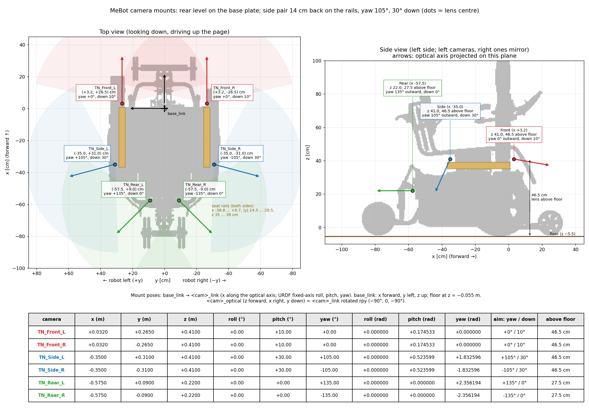
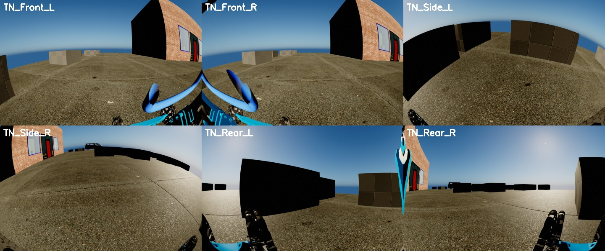

# RAMMP Gen1 fisheye kit for ramms-sim

RAMMP Gen1 (`BP_RammpGen1_Ramms`, formerly the MeBot) with six TechNexion VLS-GM2-AR0234-C-S191 fisheye cameras, streaming to
ROS 2. It is a plugin folder on the ramms-sim branch `feat/rammp-gen1-fisheye-kit`. It brings its own robot (a child
Blueprint of `BP_RammpGen1_Ramms`) and its own game mode, so ramms-sim's robot, maps and config are not
modified.





## Rig

Poses are lens centres in ROS `base_link` (x forward, y left, z up; the floor is at z = −5.5 cm). All
cameras have roll 0; yaw is measured from straight ahead, + to the robot's left. `rig.json` holds the same
poses in Unreal coordinates.

| Camera | Mount | x, y, z (cm) | Above floor | Yaw | Tilt |
| --- | --- | --- | --- | --- | --- |
| TN_Front_L / R | seat rail, front end | +3.2, ±26.5, 41 | 46.5 cm | 0° | 10° down |
| TN_Side_L / R | rail outer face, 35.7 cm behind the rail tip | −35, ±31, 41 | 46.5 cm | ±105° | 30° down |
| TN_Rear_L / R | grey base plate | −57.5, ±9, 22 | 27.5 cm | ±135° | level |

In the sim model this rig leaves 0.33 m² of ground unseen within 1 m of the chair, all of it within 25 cm
(`doc/blind_spots.png`). It sees about 89% of a person behind the chair and 73% beside it.

**Lens:** 1920 × 1200, f = 727 px, centred. Kannala-Brandt k = (0.031329, −0.027551, 0.0027694, 0), fitted to
the datasheet's 93.7° V / 154° H / 191° D field of view.

## Setup

Everything is on the ramms-sim branch `feat/rammp-gen1-fisheye-kit`, which is current `main` plus:
- this folder, `Plugins/RammpGen1FisheyeKit`;
- the CameraCapture submodule on the fisheye camera component (`feat/fisheye-camera`, from the public fork
  `prajapatisarvesh/unreal-camera-capture`; `.gitmodules` points there on this branch only);
- the RammsStreaming submodule on the ROS camera metadata (`feat/fisheye-ros-metadata`).

Neither plugin branch is merged into its plugin's `main`, and ramms-sim's `main` is untouched.

From your ramms-sim checkout:
```bash
git fetch origin
git checkout feat/rammp-gen1-fisheye-kit
git submodule sync && git submodule update --init --recursive   # sync: CameraCapture's URL differs here
```
Then **rebuild** RammsEditor, because the CameraCapture branch adds C++.

To go back, `git checkout main && git submodule sync && git submodule update --init --recursive`, then rebuild.

The kit's three assets ship ready in `Content/`. `Scripts/build_kit.py` rebuilds them, for example after
editing `rig.json`:
```bash
UnrealEditor-Cmd "$PWD/Ramms.uproject" -run=pythonscript -script="$PWD/Plugins/RammpGen1FisheyeKit/Scripts/build_kit.py" -unattended -nullrhi
```
It never saves `BP_RammpGen1_Ramms`: it checks that the file is unchanged afterwards.

## Run

```bash
Plugins/RammpGen1FisheyeKit/launch.sh [Map_Demo|Map_Dojo|...] [--foxglove]   # Ctrl+C stops everything
```
This starts ramms-sim as a standalone game on the map with the kit's game mode. The map is not edited: the
`?game=` URL option overrides the map's own game mode. It then starts the RMSS → ROS 2 bridge, and with
`--foxglove` also `foxglove_bridge` on `ws://localhost:8765`.

- **Unreal location:** set `UE_EDITOR=<UE>/Engine/Binaries/Linux/UnrealEditor` if `UnrealEditor` isn't on
  `PATH`.
- **In the editor instead:** set World Settings → GameMode Override to `BP_RammpGen1FisheyeGameMode` (don't
  save the map), press Play, then run `launch.sh --no-sim`.
- **Bridge only:** `ros/run_bridge.sh --ros-args -p compressed:=true`. It connects to RMSS on
  127.0.0.1:30030; use `-p host:=<sim machine>` for a sim on another machine.

## Topics

| Topic | |
| --- | --- |
| `/rammp_gen1/cam/TN_*/image_raw/compressed` | full-size JPEG, ~9–10 Hz per camera |
| `/rammp_gen1/cam/TN_*/preview/compressed` | half-size JPEG, for Foxglove or a subscriber over WiFi |
| `/rammp_gen1/cam/TN_*/image_raw` | raw `bgr8`, only with `-p publish_raw:=true` (heavy: ~70 MB/s for all six) |
| `/rammp_gen1/cam/TN_*/camera_info` | `distortion_model: equidistant` (OpenCV fisheye), D = k1..k4 |
| `/tf_static` | `base_link → TN_*_link → TN_*_optical` (REP-103) |
| `/tf`, `/rammp_gen1/odom/ground_truth` | `odom → base_link`, the sim's true robot pose |

Images are published best-effort, so subscribe with a best-effort QoS. Cameras captured together share a
stamp. The capture runs in 3 groups (Front, Rear, Side pairs), one group every 2nd frame, so each L/R pair
is frame-synchronised.

ROS 2 Humble. The bridge runs with `python3 -s`, which keeps `~/.local` numpy / cv2 builds out of ROS 2's.
Set `ROS_DOMAIN_ID` / `ROS_LOCALHOST_ONLY` as you usually do.

## Merging into main

The branch is built to merge cleanly. Outside this folder it only changes `.gitmodules` (CameraCapture's
URL) and the two submodule pointers; everything else lives in `Plugins/RammpGen1FisheyeKit/`. Names follow
main's RAMMP Gen1 rename: `BP_RammpGen1_*` assets and `/rammp_gen1/...` topics.

Before merging:
1. **Get the CameraCapture branch upstream.** Merge `feat/fisheye-camera` into
   `finger563/unreal-camera-capture` (it sits on that repo's current `main`, 645efb2). Then change
   `.gitmodules` back to `git@github.com:finger563/unreal-camera-capture` and point the submodule at the
   merged commit. Otherwise everyone's CameraCapture would follow the fork.
2. **Merge the RammsStreaming branch.** Merge `feat/fisheye-ros-metadata` into `rammp-org/ramms-streaming`
   and point the submodule at the merged commit.

Both plugin branches are additive. Existing cameras and stream sources behave as before unless the new
switches are set. The RMSS header, opcodes and version are unchanged; the metadata JSON only gains fields.

## Contents

| Path | |
| --- | --- |
| `Content/Robots/BP_RammpGen1_Fisheye` | child of `/Game/Robots/BP_RammpGen1_Ramms`: the six `FisheyeSceneCaptureComponent`s (with small housings, hidden from the cameras), and `RMSS_Stream`, which starts the RMSS server and a disk-free capture on Play. The parent's Orbbec Gemini units, which sit where the front fisheyes mount, are hidden and do not capture. |
| `Content/BP_RammpGen1FisheyeGameMode` | child of `/Game/BP_RammpGen1GameMode`, spawning the robot above |
| `Content/Sensors/TechNexion_AR0234_S191_Intrinsics` | the lens intrinsics |
| `rig.json`, `Scripts/build_kit.py` | camera poses and lens, and the script that builds the assets from them |
| `ros/` | the RMSS → ROS 2 bridge (`ramms_ros_bridge.py`, `run_bridge.sh`, `cyclonedds.xml`) |
| `launch.sh` | sim + bridge |

Tested 2026-11-09 on a clean ramms-sim `main` (UE 5.8, Linux, Vulkan) with the two plugin branches, on
Map_Demo: six cameras at 9.4–9.6 Hz each, `/tf_static` mounts as in the table above.
