<h1 align="center">RAMMS-Sim</h1>

<p align="center">
  <b>Robotic Assistive Mobility and Manipulation Simulation</b><br>
  A physics-based Unreal Engine 5.8 simulator for wheelchair-mounted robots:
  a powered wheelchair base with a lift and articulated casters, a Kinova Gen3
  arm with a Robotiq 2F-85 gripper, and the sidewalks, curb ramps, parks, homes,
  offices and stores they have to work in.
</p>

<p align="center">
  
  
  
  
</p>

<p align="center">
  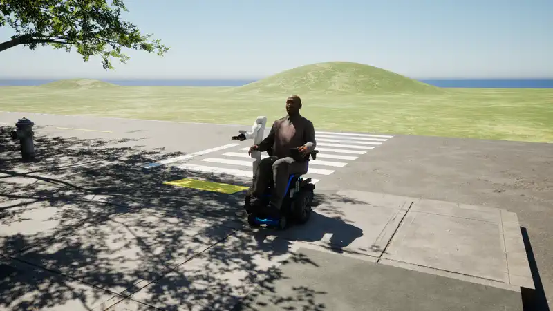
</p>

<p align="center">
  <a href="#highlights">Highlights</a> ·
  <a href="#whats-inside">What's inside</a> ·
  <a href="#whats-next">What's next</a> ·
  <a href="#getting-started">Getting started</a> ·
  <a href="#project-structure">Project structure</a> ·
  <a href="#simulation-features">Feature reference</a>
</p>

## Highlights

<table>
  <tr>
    <td width="50%" valign="top">
      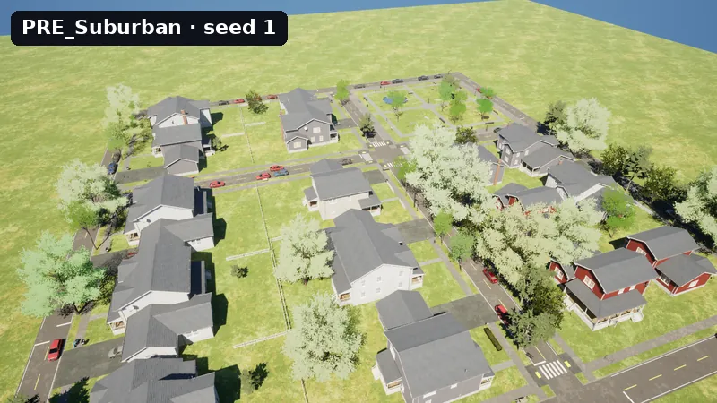<br>
      <b>Procedural, seed-driven worlds.</b> Streets, curb ramps, crosswalks,
      parks, homes, offices and stores built on PCG from a preset and a seed,
      each with a ground-truth accessibility manifest.
    </td>
    <td width="50%" valign="top">
      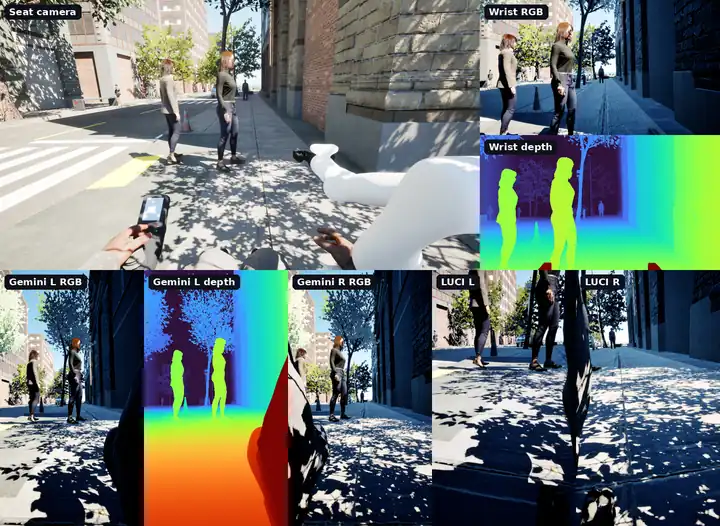<br>
      <b>Every camera on the robot.</b> The seat view plus the wrist and Orbbec
      Gemini cameras (the LUCI cameras sit alongside), each with its real
      intrinsics and mounting, rendering RGB, depth, class segmentation and
      motion vectors.
    </td>
  </tr>
  <tr>
    <td width="50%" valign="top">
      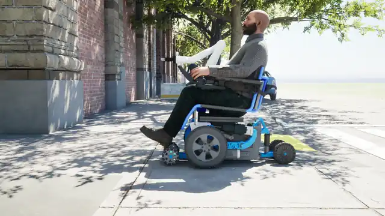<br>
      <b>An articulated base, not a box on wheels.</b> Differential drive,
      front and rear caster swing arms, a lift that raises and tilts the seat
      base, and drive wheels that slide fore and aft, each a motor you can
      command, on a 46-body physics model that holds still on slopes.
    </td>
    <td width="50%" valign="top">
      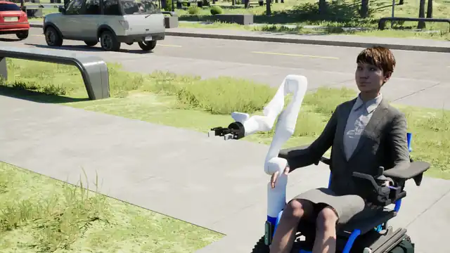<br>
      <b>A physics-driven arm and gripper.</b> Kinova Gen3 with DLS, FABRIK and
      CCD inverse kinematics, end-effector teleoperation and a Robotiq 2F-85,
      with link masses from the manufacturer's data.
    </td>
  </tr>
  <tr>
    <td width="50%" valign="top">
      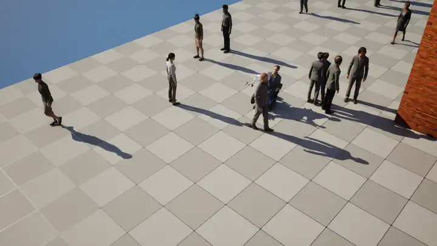<br>
      <b>People who notice the robot.</b> Mass Entity pedestrians walk lanes
      around the chair, avoid it, turn to look at it and flinch when it comes
      too close, each with their own walk, idle and phone, cup or bag, in test
      plazas and on the generated sidewalks.
    </td>
    <td width="50%" valign="top">
      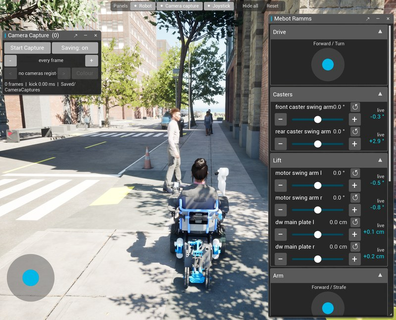<br>
      <b>Drive it from anywhere.</b> In-game panels generated from the
      robot's own control surface, keyboard and gamepad, Python over Remote
      Control, a browser over Pixel Streaming, BCI and switch input, or an AI
      assistant over MCP.
    </td>
  </tr>
</table>

## What's inside

**Robots and physics**
- **MeBot powered wheelchair base**: differential drive with torque and velocity
  modes, odometry, front/rear caster swing arms, a lift that raises and tilts
  the base, and drive wheels that slide fore and aft for front-, mid- and
  rear-wheel drive. A parking brake brings a stopped chair to
  rest and holds it on ramps.
- **Kinova Gen3 arm and Robotiq 2F-85 gripper**: a skeletal arm on per-joint
  physics constraints; joint, end-effector, velocity and torque control; three IK
  solvers with null-space preferred poses; realistic link masses.
- **One robot model, three physics engines**: every controller drives motors by
  id through `RammsRobotBaseComponent`, which resolves a backend once: Chaos
  skeletal bodies, MuJoCo through
  [UnrealRoboticsLab](https://github.com/rammp-org/UnrealRoboticsLab), or the
  experimental [Newton](https://github.com/newton-physics/newton) worker.
- **A seated person and other robots**: an operator seated in the chair,
  lift-drive and holonomic research platforms, an accessible van with an
  articulated ramp, and an ADA door.

**Sensing**
- **Calibrated cameras**: pixel intrinsics (fx, fy, cx, cy) and reusable sensor
  presets (e.g. RealSense D435) on cameras mounted where the real Orbbec Gemini,
  LUCI and wrist cameras sit, writing 32-bit EXR RGB + depth + motion vectors
  with per-frame JSON metadata.
- **GPU ray-traced range sensors**: time-of-flight (single point like the
  VL53L0X or an NxM grid like the VL53L5CX) and sonar cones traced inline on RT cores, plus an IMU with
  noise, bias and filtering.
- **Streaming out**: the RMSS binary protocol streams RGB, depth, RGB-D, motion
  and point clouds over TCP to Python or ROS tooling.

**Worlds and people**
- **RammsWorldGen**: seed-driven downtown, main-street, suburban, park, home,
  office and store levels on UE 5.8 PCG, with curb ramps, entrances (level,
  stepped, ramped), hazards and a `NonCompliance` dial that breaks features on
  purpose. Every world exports a manifest of routes, clear widths and
  accessibility violations.
- **RammsCrowd**: Mass Entity pedestrians on ZoneGraph lanes that avoid the
  robot and react to it in aware, react and startle zones, animated with
  body-type walk and idle variants, carried props, directional walks played at
  the speed their feet need, head look-at and bump reactions.

**Ways in**
- **Control surface**: a robot describes its controls (`drive.forward`,
  `lift.*`, `arm.*`, `gripper.*`, `camera.*`), and every input source drives
  that description, with arbitration between them.
- **In-game UI**: floating panels, joysticks and sliders built from that
  description, plus camera-capture and status panels.
- **RammsAccess**: alternative-access input (BCI, head mice, eye gaze, switches)
  normalized into one intent stream with a watchdog and e-stop.
- **Remote**: [ramms-tools](https://github.com/rammp-org/ramms-tools) CLIs and
  a Python library over the Remote Control API, Pixel Streaming to any browser
  (WASD and touch), and an in-editor MCP server with a RAMMS toolset for AI
  assistants.

**Scale and testing**
- Headless rendering builds for Linux, cross-compiled from Windows, with a
  container definition for GPU clusters.
- Play-in-Editor suites for the Chaos and MuJoCo bases (drive, turn, lift,
  arm, stopping on a ramp, remote access), camera capture, the seat, teleop and
  Newton, a mini-golf course where a Gen3 putts a free ball under MuJoCo, plus
  C++ automation tests.

## What's next

Work in progress and planned, with the design notes in [`doc/`](doc):

- **Parallel headless simulation** on SLURM GPU clusters for policy training
  and dataset collection ([plan](doc/PARALLEL_SIM_PLAN.md)).
- **MuJoCo-first robots**: driving the bases in MuJoCo, seating a person in the
  simulated chair alongside the crowd, and Python scene generation
  ([roadmap](doc/mujoco_sim_roadmap.md)).
- **Generated worlds in MuJoCo**: exporting RammsWorldGen curbs, ramps, steps
  and walls into the MuJoCo spec so MuJoCo-driven robots collide with them
  ([design](doc/worldgen_mujoco_export.md)).
- **Semantic segmentation** as a third CameraCapture plane next to depth and
  motion ([plan](doc/camera_segmentation_plan.md)).
- **Controllers as their own plugin**, `ramms-controllers`
  ([plan](doc/controllers_extraction.md)), and a **holonomic drive** with a
  positional pad for the 5-bar linkage robots
  ([scope](doc/holonomic_drive_and_position_pad.md)).
- **Articulated household assets** (cabinets, drawers, fridges, microwaves)
  from Blender to Unreal, MuJoCo, Newton and Isaac
  ([pipeline](doc/dojo_asset_pipeline.md)).
- **Remote HMI over Pixel Streaming** for the rammp-ui operator interface
  ([plan](doc/PIXEL_STREAMING_PLAN.md)), and RammsAccess intents driving the
  physical robot as well as the simulated one.

## Getting started

### Prerequisites

- **Unreal Engine 5.8**
- **Windows** with DirectX 12 (recommended) or **Linux** with Vulkan SM6
- **Visual Studio 2022** (Windows) — with the *Game development with C++*
  workload (MSVC toolchain), required both by UE 5.8 and to compile the
  native third-party dependencies
- **CMake** — On your `PATH`, for building the unreal-robotics-lab
  third-party dependencies
- **GPU with ray tracing support** — Required for GPU-accelerated sensors;
  RT cores used when available, software ray tracing otherwise
- **Python 3.10+** (optional) — For remote execution scripts

### Installation

First-time setup is four steps: clone with submodules, build the
`unreal-robotics-lab` native third-party dependencies, download the Fab
content packs, and open the project. Steps 2 and 3 are required **before**
the first build/launch — skipping step 2 makes the build fail outright, and
skipping step 3 leaves example maps and the crowd system without their assets.

#### 1. Clone with submodules

This repository uses git submodules for plugins. Clone recursively:

```bash
git clone --recursive https://github.com/rammp-org/ramms-sim.git
cd ramms-sim
```

If you've already cloned without `--recursive`, initialize the submodules:

```bash
git submodule update --init --recursive
```

#### 2. Build the unreal-robotics-lab third-party dependencies

The `URLab` module (pulled in via `unreal-robotics-lab` and
`RammsMujocoSupport`) links against native libraries — **MuJoCo**, **CoACD**,
and **libzmq** — that are compiled from source into
`Plugins/unreal-robotics-lab/third_party/install/`. This must be done once
before the first project build, and again whenever the `unreal-robotics-lab`
submodule pointer moves (each dependency's build script records the installed
SHA, and the build system enforces a drift check against it).

Requires **CMake** and a C++ toolchain (Visual Studio 2022 / MSVC on
Windows, Xcode command-line tools on macOS) on your `PATH` — see
[Prerequisites](#prerequisites).

**Windows (PowerShell):**
```powershell
cd Plugins/unreal-robotics-lab/third_party
./build_all.ps1
```

You then have to build the protospec for the URL module:

**Windows (PowerShell):**
```powershell
cd Plugins/unreal-robotics-lab/protospec
./build.ps1
```

The script syncs each dependency's source submodule to the expected revision,
builds it in Release, and installs into `third_party/install/`.

**macOS / Linux:** do **not** run `build_all.sh` directly. Run the setup
script from the repository root instead; it verifies the submodule, applies the
one nested patch that can't live on our fork, builds the third-party
dependencies, and regenerates project files:

```bash
UE_ROOT="/Users/Shared/Epic Games/UE_5.8" Scripts/setup_urlab.sh
```

Our fixes to unreal-robotics-lab (the `nil` macro clash between Apple's
`MacTypes.h` and rpclib/msgpack, the Mac dylib link branch in `URLab.Build.cs`,
the `MjBody` world-body render fix, the quick-convert preview refresh, and the
build-script dylib staging) now live on **our fork**, not in a patch file —
see [The unreal-robotics-lab fork](#the-unreal-robotics-lab-fork) below. The
submodule pins the fork branch, so `git submodule update --init` already brings
them. The only thing `setup_urlab` still patches is the **nested** CoACD source
submodule (`Scripts/patches/coacd-src-local-fixes.patch`), which can't live on
our fork because we don't own CoACD's repo — so re-run `setup_urlab` after a
`git submodule update --recursive`, which reverts that nested patch.

The script is idempotent — re-run it any time. Flags: `--no-thirdparty` skips
the dependency build, `--no-projectfiles` skips project file generation;
`UE_ROOT` defaults to `/Users/Shared/Epic Games/UE_5.8`.

##### The unreal-robotics-lab fork

The `unreal-robotics-lab` submodule points at **our fork**,
`git@github.com:rammp-org/UnrealRoboticsLab`, pinned to branch
**`ramms/v0.6.0-beta`** — the upstream `v0.6.0-beta` tag plus our committed
fixes (grouped by category in that branch's commit for easy upstreaming). The
fork keeps an `upstream` remote (`urlab-sim/UnrealRoboticsLab`) so each fix can
be split onto a clean branch and PR'd back.

If you cloned **before** the submodule moved to the fork, point your local
checkout at the new URL:

```bash
git submodule sync Plugins/unreal-robotics-lab
git submodule update --init --recursive Plugins/unreal-robotics-lab
```

New recursive clones pick up the fork automatically from `.gitmodules`.

> If you skip this step, compiling `RammsEditor` fails at the build-rules
> stage with an error like `MuJoCo install is missing '...INSTALLED_SHA.txt'`.
> The same error after a `git pull` means the submodule moved — re-run
> `build_all.ps1` (Windows) or `Scripts/setup_urlab.sh` (macOS/Linux) to
> refresh the installs.

#### 3. Download content packs from Fab

Marketplace content under `Content/Fab/` is **not committed** to the
repository (multi-GB size, and the Fab license requires each user to claim
the free packs themselves). Without it the project still builds and runs, but
example environments show missing assets and the crowd system falls back to
proxy meshes.

- **City Sample Crowds** (required for the crowd system) — claim and install
  via **Epic Games Launcher → Fab Library → City Sample Crowds → Add to
  Project**, then restart the editor. The `RammsCrowd` plugin detects the
  pack on editor startup and automatically migrates it to
  `/Game/Fab/CitySampleCrowd` (one-time, a few minutes, with toast
  notifications). If it is missing, an editor toast links to the Fab listing
  and crowd agents simulate with proxy meshes. See
  `Plugins/RammsCrowd/doc/SETUP.md` §0 for details.
- **Example environment & prop packs** (optional) — the example maps use a
  number of free packs (furniture, grocery/supermarket props, street/urban
  environments, etc.). Claim them on [Fab](https://www.fab.com) and add them
  to the project via the **Fab plugin** inside the Unreal Editor so they land
  under `Content/Fab/`. A map that references a pack you haven't installed
  simply shows missing-asset placeholders for those actors.

#### 4. Open the project

Open `Ramms.uproject` in Unreal Engine 5.8. The plugins are automatically
detected and compiled (or build from the command line — see the next
section).

### Building from the Command Line

You can compile the C++ (project module + all plugin modules, including
`RammsCore`) entirely from a terminal without opening the editor. This is the
fastest way to validate C++ changes in CI or after editing controllers/plugins.

These commands invoke **UnrealBuildTool (UBT)** through the engine's batch
scripts. They build directly from `Ramms.uproject` and the `.Target.cs` files —
generating IDE project files is optional (see the last subsection).

> Prerequisites: submodules initialized and the unreal-robotics-lab
> third-party dependencies built (see [Installation](#installation)), plus a
> full UE 5.8 installation. The required .NET toolchain ships with the engine.

The project defines two targets:

| Target | Use |
|--------|-----|
| `RammsEditor` | Editor modules — build this to load the project (and your C++) in the editor or to run editor/commandlet/headless-editor sessions. |
| `Ramms` | Standalone game/runtime — build this for packaged or `-game` runs. |

Valid build configurations: `Debug`, `DebugGame`, `Development` (default),
`Test`, `Shipping`. Platform tokens: `Win64`, `Mac`, `Linux`.

#### Locate your engine installation

Set a variable pointing at your UE 5.8 root, then reuse it below. Adjust the
path to match your install.

**Windows (PowerShell):**
```powershell
$UE = "C:\Program Files\Epic Games\UE_5.8"
```

**Windows (cmd):**
```bat
set "UE=C:\Program Files\Epic Games\UE_5.8"
```

**macOS (zsh/bash):**
```bash
UE="/Users/Shared/Epic Games/UE_5.8"
```

**Linux (bash):**
```bash
UE="$HOME/UnrealEngine"   # your UE 5.8 install/build root (no Epic launcher on Linux)
```

Run the commands below from the repository root (the folder containing
`Ramms.uproject`).

#### Compile the editor target

This is the usual command after changing C++ — it rebuilds the project and every
plugin module, so you can launch the editor without triggering a Live Coding /
hot-reload pass.

**Windows (PowerShell):**
```powershell
& "$UE\Engine\Build\BatchFiles\Build.bat" RammsEditor Win64 Development -Project="$PWD\Ramms.uproject" -WaitMutex
```

**macOS:**
```bash
"$UE/Engine/Build/BatchFiles/Mac/Build.sh" RammsEditor Mac Development -Project="$PWD/Ramms.uproject" -WaitMutex
```

**Linux:**
```bash
"$UE/Engine/Build/BatchFiles/Linux/Build.sh" RammsEditor Linux Development -Project="$PWD/Ramms.uproject" -WaitMutex
```

#### Compile a standalone game target

Swap the target to `Ramms` (and pick a configuration, e.g. `Shipping`) to build
the runtime game module:

**Windows (PowerShell):**
```powershell
& "$UE\Engine\Build\BatchFiles\Build.bat" Ramms Win64 Development -Project="$PWD\Ramms.uproject" -WaitMutex
```

**macOS / Linux:** use the platform's `Build.sh` (as above) with target `Ramms`
and platform `Mac` / `Linux`.

#### Package the project

To cook content and produce a runnable build (not just compile), use the
Unreal Automation Tool (`RunUAT`):

**Windows (PowerShell):**
```powershell
& "$UE\Engine\Build\BatchFiles\RunUAT.bat" BuildCookRun `
  -Project="$PWD\Ramms.uproject" -NoP4 `
  -Platform=Win64 -ClientConfig=Development `
  -Build -Cook -Stage -Pak -Archive -ArchiveDirectory="$PWD\Packaged"
```

**macOS / Linux:**
```bash
"$UE/Engine/Build/BatchFiles/RunUAT.sh" BuildCookRun \
  -Project="$PWD/Ramms.uproject" -NoP4 \
  -Platform=Mac -ClientConfig=Development \
  -Build -Cook -Stage -Pak -Archive -ArchiveDirectory="$PWD/Packaged"
```
(Use `-Platform=Linux` on Linux.) The packaged output lands in `Packaged/`.

#### Cross-compile for Linux from Windows

Linux builds (e.g. for headless simulation on clusters — see
`doc/PARALLEL_SIM_PLAN.md`) can be produced entirely on a Windows machine
using Epic's standard Windows→Linux cross-compilation workflow. This needs a
**one-time toolchain install**:

1. Download the **native toolchain** installer for your engine version from
   Epic's [Linux Development Requirements](https://dev.epicgames.com/documentation/en-us/unreal-engine/linux-development-requirements-for-unreal-engine)
   page — for **UE 5.8** that is **v26 clang-20.1.8 rockylinux8**
   (`v26_clang-20.1.8-rockylinux8.exe`).
2. Run the installer. It is fully automated: it unpacks the clang/lld
   cross-toolchain and sysroot (default: `C:\UnrealToolchains\<version>\`)
   and sets the `LINUX_MULTIARCH_ROOT` environment variable machine-wide.
3. **Open a new terminal** (existing shells don't see the new environment
   variable), and verify:

   ```powershell
   echo $env:LINUX_MULTIARCH_ROOT
   # -> C:\UnrealToolchains\v26_clang-20.1.8-rockylinux8\
   ```

With the toolchain in place, build and package with the repo scripts (they
apply the required URLab patches automatically and cross-compile the
MuJoCo/CoACD/libzmq third-party libraries into `third_party/install-linux/`
before the UBT build):

```powershell
# 1. Cross-compile URLab third-party deps (once, and after submodule bumps)
powershell -ExecutionPolicy Bypass -File Scripts\build_all_linux_cross.ps1

# 2. Build the Linux game target; add -Package to cook/stage/pak
powershell -ExecutionPolicy Bypass -File Scripts\build_linux_cross.ps1 -Package
```

The packaged output lands in `Packaged\Linux` — copy it to a Linux machine
(or bundle it with `containers/ramms.def`) and launch via
`Scripts/run_headless.sh`. Both scripts check for the toolchain and fail
with install instructions if `LINUX_MULTIARCH_ROOT` is missing.

#### Regenerate IDE project files (optional)

Only needed for IDE/IntelliSense (Visual Studio, Rider, VS Code, Xcode) or after
adding modules / editing a `.Build.cs`. It is **not** required for the
command-line builds above.

**Windows (PowerShell):**
```powershell
& "$UE\Engine\Build\BatchFiles\Build.bat" -ProjectFiles -Project="$PWD\Ramms.uproject" -Game -Engine -Progress
```

**macOS:**
```bash
"$UE/Engine/Build/BatchFiles/Mac/GenerateProjectFiles.sh" -Project="$PWD/Ramms.uproject" -Game -Engine
```

**Linux:**
```bash
"$UE/Engine/Build/BatchFiles/Linux/GenerateProjectFiles.sh" -Project="$PWD/Ramms.uproject" -Game -Engine
```

## Project Structure

### Plugin Submodules

The project uses a modular plugin architecture. Fourteen plugins are managed as
git submodules:

| Plugin | Path | Description |
|--------|------|-------------|
| **RammsCore** | `Plugins/RammsCore/` | Core simulation components — differential drive, MeBot controller, Kinova Gen3 arm with IK solvers, gripper, sensor simulation (ToF, Sonar, IMU), GPU ray tracing, URDF import/export |
| **CameraCapture** | `Plugins/CameraCapture/` | Multi-camera capture system — RGB + depth + motion vectors with custom camera intrinsics, EXR output, and frustum visualization |
| **RammsStreaming** | `Plugins/RammsStreaming/` | Real-time binary streaming over TCP (RMSS protocol, port 30030) — image data, depth frames, motion vectors, point clouds |
| **RammsAssets** | `Plugins/RammsAssets/` | 3D models and materials — Kinova Gen3 arm, gripper, MeBot base, operator seat, ORBBEC and LUCI camera models |
| **RammsHumanPhysics** | `Plugins/RammsHumanPhysics/` | Experimental human body physics plugin for RAMMS |
| **RammsNewtonPhysics** | `Plugins/RammsNewtonPhysics/` | Experimental Newton Dynamics integration scaffold — third-party detection, fixed-step subsystem, actor bridge component, and articulated robot API for Newton-first full-robot simulation |
| **RammsMujocoPhysics** | `Plugins/RammsMujocoPhysics/` | Experimental MuJoCo integration scaffold — third-party detection, fixed-step subsystem, and actor bridge component for selective external simulation |
| **RammsMujocoSupport** | `Plugins/RammsMujocoSupport/` | Support utilities, classes and content for MuJoCo-based simulation, including end-effector IK teleoperation for the URLab Kinova Gen3 and gripper articulation |
| **unreal-robotics-lab** | `Plugins/unreal-robotics-lab/` | URLab: MuJoCo physics for Unreal Engine, with MJCF import, 40+ sensors, ZMQ networking, debug visualization, and record/replay |
| **RammsCrowd** | `Plugins/RammsCrowd/` | Mass Entity NPC crowd simulation (ZoneGraph/NavMesh locomotion) with a data-driven framework for NPC reactions to robots and vehicles |
| **RammsAccess** | `Plugins/RammsAccess/` | Alternative-access input: a normalized intent stream from external devices (BCI, HID/pointer, assistive switches) mapped onto the drive, arm and gripper controllers |
| **RammsControl** | `Plugins/RammsControl/` | Dependency-light control-surface model: how a robot describes its controls and how any input source drives them (no UMG, no physics) |
| **RammsUI** | `Plugins/RammsUI/` | User interface components and tools |
| **RammsPrivateAssets** | `Plugins/RammsPrivateAssets/` | Private content (lift-drive CAD meshes, MJCF-derived articulations, and the pawns, tables and test map built on them). Content only; enabled automatically when present |
| **RammsWorldGen** | `Plugins/RammsWorldGen/` | Procedural, seed-driven pedestrian / wheelchair worlds on PCG (streets, parks, homes, offices, stores) with crowds and a ground-truth accessibility manifest ([ramms-worldgen](https://github.com/rammp-org/ramms-worldgen)); see [doc/world_generation.md](doc/world_generation.md) |

### Directory Layout

```
ramms-sim/
├── Config/                    Project configuration (.ini files)
├── Content/                   Blueprints, materials, meshes, levels
│   ├── Blueprints/              Game logic (BP_MebotGameMode, etc.)
│   ├── Maps/                    Test and demo levels (Map_Demo, Map_ArmTest, Map_RampTest, ...)
│   │   └── Gen/                 Generated example worlds (Map_Gen_Downtown, _Park, _Office, ...)
│   ├── Robots/                  Robot blueprints (BP_Mebot_Ramms, BP_Mebot_Mujoco, BP_Kinova_Gen3, ...; pawns: doc/robot_pawn.md)
│   ├── Vehicles/                Accessible van with ramp
│   ├── ada_door/                Accessible door system
│   ├── Python/                  init_unreal.py and the RAMMS MCP toolset
│   └── Fab/                     Fab marketplace packs (not committed; see Installation)
├── Plugins/                   Plugin submodules (see the table above)
│   ├── RammsCore/               Robot base, controllers, IK, sensors, GPU ray tracing, URDF
│   ├── RammsControl/            Control-surface model
│   ├── RammsUI/                 Panels, joysticks, camera widgets
│   ├── RammsWorldGen/           Procedural worlds
│   ├── RammsCrowd/              Pedestrian crowds
│   ├── CameraCapture/           Calibrated cameras and EXR capture
│   ├── RammsStreaming/          RMSS TCP streaming
│   ├── RammsAccess/             Alternative-access input
│   ├── unreal-robotics-lab/     URLab (MuJoCo), our fork
│   ├── RammsMujoco*/            MuJoCo integration and support
│   ├── RammsNewtonPhysics/      Newton worker bridge
│   └── ...
├── Source/Ramms/              Main game module (robot pawns, player controller, game mode)
├── Scripts/                   Build, packaging, editor remote execution, worldgen and PIE test scripts
├── containers/                Apptainer definition for headless cluster runs
├── doc/                       Design notes, plans and images (README media in doc/images/readme/)
└── Ramms.uproject             Project file
```

## Simulation Features

### Mobile Robotic Base (MeBot)

Complete simulation of the MeBot powered wheelchair base:
- Differential drive with torque and velocity control modes
- PID feedback, slip modeling, and odometry tracking
- Front and rear caster arm articulation
- A lift (motor swing arms) that raises and tilts the base, and drive wheels
  that slide fore and aft for front-, mid- and rear-wheel drive
- A parking brake that brings a stopped chair to rest and holds it on ramps
- Configurable motor parameters (max RPM, torque curves, braking)

**Components:** `URammsDifferentialDriveController`, `UMebotControllerComponent`,
`URammsDifferentialDriveLibrary`

### Kinova Gen 3 Manipulator

Physics-based 7-DOF Kinova Gen3 with a Robotiq 2F-85 gripper (the skeletal mesh
asset is named `gen3_6dof`, but the arm is the 7-DOF variant):
- Skeletal mesh with per-joint physics constraints
- Three IK solver algorithms: **DLS** (Damped Least Squares), **FABRIK**
  (per-joint scalar DLS), and **CCD** (Cyclic Coordinate Descent)
- Joint, end-effector, position, velocity, and torque control modes
- Two-finger adaptive gripper with open/close/toggle state machine
- Null-space optimization for preferred poses

**Components:** `UKinovaGen3ControllerComponent`,
`UGripperControllerComponent`, `URammsIKLibrary`

See the [RammsCore README](Plugins/RammsCore/README.md) for detailed IK solver
documentation and tuning guides.

### Physics Backends

Controllers never touch physics directly. A robot carries one
`URammsRobotBaseComponent`, which loads a motor registry (a DataTable of motor
ids, types and ranges) and resolves a backend once; every drive, lift and
linkage controller then commands motors by id. The same controllers run on:

- **Chaos** skeletal bodies (the default `BP_Mebot_Ramms`), with async physics
  at a fixed 10 ms step, constraint-motor brakes and slope holding.
- **MuJoCo** through URLab (`BP_Mebot_Mujoco`, `BP_Gen3_Mujoco`), with MJCF
  import, 40+ sensors and record/replay.
- **Newton** (experimental): URLab's MuJoCo data model stepped by an
  out-of-process [Newton](https://github.com/newton-physics/newton) worker on
  NVIDIA Warp (`BP_Kinova_Gen3_Newton`).

<p align="center">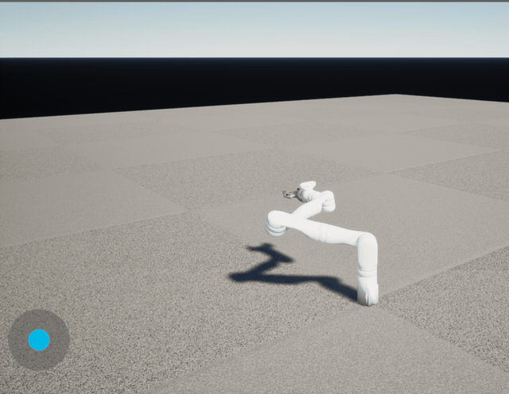</p>

See [doc/base_component_controls.md](doc/base_component_controls.md),
[doc/mujoco_sim_roadmap.md](doc/mujoco_sim_roadmap.md) and
[doc/robot_pawn.md](doc/robot_pawn.md).

### Accessible Van with Ramp

Articulated accessible van system:
- Controllable van door with keyframe animation
- Articulated van ramp with realistic physics and easing curves

**Components:** `UVanDoorComponent`, `UVanRampComponent`

**Credits:** Custom modification of CC-licensed base model: "Volkswagen ID.
BUZZ" (https://skfb.ly/oTs6B) by Sloftm_Carz, licensed under
[CC-BY 4.0](http://creativecommons.org/licenses/by/4.0/).

### Sensor Simulation

Three sensor types with configurable noise, bias, update rate, and debug
visualization:

| Sensor | Component | Description |
|--------|-----------|-------------|
| **Time-of-Flight** | `URammsToFSensorComponent` | Single-point or NxM grid distance sensor (modeled after VL53L0X / VL53L5CX). GPU or CPU ray tracing. |
| **Sonar / RADAR** | `URammsSonarSensorComponent` | Cone-beam distance sensor with golden-angle spiral ray distribution. GPU or CPU ray tracing. |
| **IMU** | `URammsIMUSensorComponent` | Accelerometer + gyroscope + orientation. Supports gravity, EMA filtering, dead-bands, bias, and noise. |

The ToF and Sonar sensors support **GPU-accelerated ray tracing** via a
compute shader with DXR inline ray tracing (`TraceRayInline`). The GPU path:
- Uses hardware RT cores when available, software ray tracing otherwise
- Falls back automatically to CPU `LineTrace` when GPU is unavailable
- Is controlled per-component via `bUseGPURayTracing` (default: on)
- Shows as `RammsSensorTraceDispatch` in `stat gpu` for profiling

All sensors fire along their local **+X axis** and provide shape
visualization in the editor viewport (frustum for ToF grid, line for ToF
single-point, cone for sonar) with configurable colors and filled planes.

See the [RammsCore README](Plugins/RammsCore/README.md) for detailed sensor
configuration and GPU ray tracing setup.

### Camera Capture System

Production-grade multi-camera capture for simulation and research:

- **Custom camera intrinsics** — Pixel-based parameters (fx, fy, cx, cy)
  for precise real-world camera matching
- **Reusable presets** — Data Assets for sensor profiles (e.g.,
  `DA_RealSense_D435`)
- **Multi-modal output** — RGB, depth (in alpha channel), and motion vectors
  as 32-bit float EXR files with per-frame JSON metadata
- **Semantic segmentation** — a class mask per camera from the custom-depth
  stencil: 8-bit fine and coarse class PNGs per frame, with the class table
  (`segmentation_classes.csv` / `.json`) beside them. Generated worlds come
  labelled (palette slots, surfaces, procedural pieces); pedestrians are
  `Person` and the robot `Robot`. 149 fine classes roll up to 29 coarse ones
  (`Config/DefaultGame.ini`). The camera capture panel's **Classes** button
  turns it on and adds fine and coarse class views, with the class under the
  pointer named below the feed. See
  [Scripts/pie_tests/camera_capture/SEGMENTATION.md](Scripts/pie_tests/camera_capture/SEGMENTATION.md).
- **Frustum visualization** — Editor viewport shape with filled translucent
  planes

**Components:** `UIntrinsicSceneCaptureComponent2D`, `UCaptureComponent`,
`ACameraCaptureManager`

<table>
  <tr>
    <td width="50%" valign="top">
      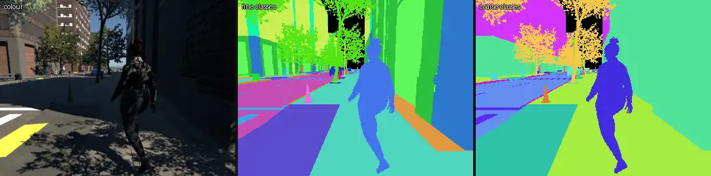<br>
      <sub>Downtown: colour, fine classes, coarse classes.</sub>
    </td>
    <td width="50%" valign="top">
      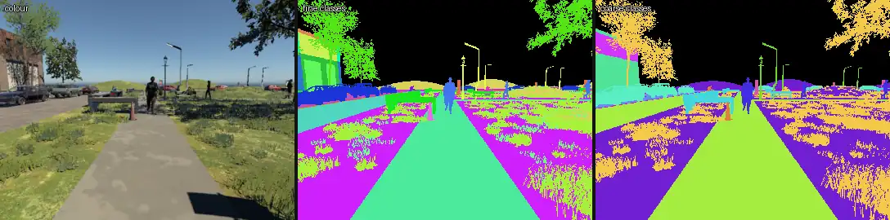<br>
      <sub>Main street square: foliage is cut out leaf by leaf, pedestrians come out whole.</sub>
    </td>
  </tr>
</table>

<p align="center">
  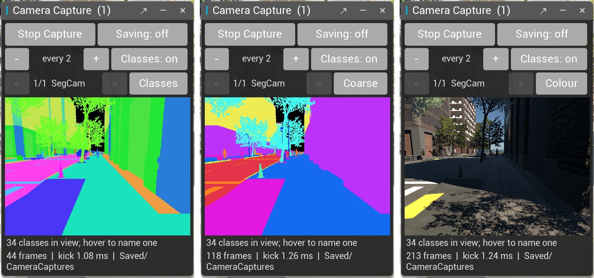<br>
  <sub>The camera capture panel: <b>Classes</b>, <b>Coarse</b> and <b>Colour</b> views of the same camera.</sub>
</p>

### Real-Time Streaming

Binary streaming over TCP for external tools and controllers:

- **RMSS protocol** with 32-byte header + JSON metadata + binary payload
- **Message types:** Image data, depth frames, motion vectors, point clouds,
  subscribe/unsubscribe, ping/ack
- **Compression:** None, LZ4, JPEG, or PNG
- **Default port:** 30030

**Components:** `URammsStreamSourceComponent`, `URammsStreamSinkComponent`,
`URammsStreamingSubsystem`

### Control Surface, UI and Input

A robot **describes** the controls it offers as a control surface (`RammsControl`):
ids such as `drive.forward`, `lift.front_caster_swing_arm`, `arm.up`,
`gripper.close` and `camera.next`, each with a kind, units and a range. Every
input source drives that description through one sink with source
arbitration, so nothing hard-codes a key map or a motor name:

- **In-game panels** (`RammsUI`): floating drive joystick, caster and lift
  sliders, arm pad, camera-capture (colour, depth, motion and class views) and
  status panels, generated from the surface.
- **Keyboard, gamepad and Enhanced Input** maps bound to control ids.
- **RammsAccess**: BCI (OpenBCI Galea), pointer / HID devices (head mice, eye
  gaze) and assistive switches, sent as a versioned intent stream over UDP with
  a silence watchdog and an e-stop latch.
- **Remote clients**: ramms-tools over the Remote Control API, the MCP toolset,
  and Pixel Streaming.

See [doc/base_component_controls.md](doc/base_component_controls.md) and
[doc/ui_input_refactor_plan.md](doc/ui_input_refactor_plan.md).

### Pedestrian Crowds

`RammsCrowd` spawns Mass Entity pedestrians (City Sample Crowds meshes) on
ZoneGraph lanes and NavMesh. They follow lanes, steer and avoid each other and
the robot, and react to it through a stimulus registry: aware, react and
startle zones with hysteresis and a closing-speed rule, tuned per kind in data
assets. The robot pawn is mirrored into Mass so crowds see it without a
character capsule, and its footprint is a hard boundary they walk around. They
plan a pass a few metres out, keeping right when they meet the chair head-on,
turn gently, leave a comfortable gap and slow down alongside it; a parked chair
startles nobody, one driving at them does.
The generated worlds place crowds on their sidewalks.

Each pedestrian is animated by `URammsCrowdAnimInstance` from
`Content/NPCs/DA_CrowdAnimSet`: a walk and idle for their body type, sometimes
a phone, cup, backpack, briefcase or purse in hand, and forward, brisk and
directional walks blended by travel direction and played at the rate that keeps
their feet planted. They turn their heads toward the chair's user once they
notice it and flinch when startled or bumped. See
`Plugins/RammsCrowd/README.md` and `Plugins/RammsCrowd/doc/CUSTOMIZATION.md`.

## Pixel Streaming (Remote Browser Access)

View and drive the sim from any web browser — desktop, tablet, or phone —
with no client install. Built on Unreal's Pixel Streaming 2 plugin (WebRTC):
the sim hardware-encodes its viewport and streams it out; browser
mouse/keyboard/touch input streams back in. Works for local dev sessions,
watching headless cluster instances live, and multi-viewer demo setups.

Quick start (two processes + a browser):

```bash
# 1. Signalling server (one-time setup: clone Epic's PixelStreamingInfrastructure
#    at the UE5.8 branch, `npm install && npm run build`)
cd PixelStreamingInfrastructure/SignallingWebServer
node ./dist/index.js --serve --http_root ./www --player_port 8080 --streamer_port 8888
```

```powershell
# 2. Any -game or packaged launch, plus the connection URL flag
& "$UE\Engine\Binaries\Win64\UnrealEditor.exe" "$PWD\Ramms.uproject" Map_Demo `
  -game -windowed -resx=1280 -resy=720 `
  -PixelStreamingConnectionURL=ws://127.0.0.1:8888 -log
```

Then open **http://127.0.0.1:8080** and click into the page — WASD drives
the chair. Other devices on the LAN use the host's IP; extra viewers are
just extra tabs.

RAMMS automatically hardens the video path at startup (it swaps the default
streamer to a viewport-only capture producer — stock UE 5.8 captures every
window and goes silently black if e.g. a notification toast is open).

See **[doc/PIXEL_STREAMING.md](doc/PIXEL_STREAMING.md)** for macOS/Linux
launch commands, flags, architecture, and troubleshooting, and
[doc/PIXEL_STREAMING_PLAN.md](doc/PIXEL_STREAMING_PLAN.md) for the cluster /
remote-HMI / demo roadmap.

## Configuration

### Renderer & Ray Tracing

The project is configured for DX12 with hardware ray tracing and Lumen
global illumination. Key settings in `Config/DefaultEngine.ini`:

| Setting | Value | Purpose |
|---------|-------|---------|
| `DefaultGraphicsRHI` | `DefaultGraphicsRHI_DX12` | DirectX 12 rendering |
| `r.RayTracing` | `True` | Enable ray tracing support |
| `r.Lumen.HardwareRayTracing` | `True` | Lumen HW RT (populates TLAS for sensors) |
| `r.DynamicGlobalIlluminationMethod` | `1` | Lumen dynamic GI |
| `r.ReflectionMethod` | `1` | Lumen reflections |
| `r.Shadow.Virtual.Enable` | `1` | Virtual shadow maps |
| `r.Substrate` | `True` | Substrate material system |
| `r.AllowStaticLighting` | `False` | Fully dynamic lighting |

> **⚠ Important:** Avoid `r.RayTracing.ForceAllRayTracingEffects=1` — it
> breaks `DrawDebugMesh` rendering used by sensor and camera frustum
> visualization. Lumen HW RT naturally populates the TLAS for sensor traces.

### Game Settings

- **Default map:** `Maps/Map_Demo`
- **Default game mode:** `BP_MebotGameMode` (pawn `BP_Mebot_Ramms`, controller `ARammsPlayerController`)
- **Splitscreen:** Enabled (2-player horizontal, 3-player top-favored)

## Python Integration

`Scripts/editor_remote_exec.py` is a dependency-free client for UE's Python
Remote Execution. It runs a snippet or a script file inside a running editor
and prints the editor-side output:

```bash
python Scripts/editor_remote_exec.py --code "unreal.log('hi')"
python Scripts/editor_remote_exec.py --file path/to/script.py
python Scripts/editor_remote_exec.py --eval "unreal.SystemLibrary.get_project_directory()"
```

Remote Execution is enabled in this project's settings (multicast
239.0.0.1:6766, loopback). For another project, enable it under **Edit >
Project Settings > Plugins > Python > Remote Execution > Enable Remote
Execution**.

The PIE test runners under `Scripts/pie_tests/` drive the editor through it.

### Recording a run for video

The physics backend does not run in real time under the Movie Render Queue, so
to film a simulated behaviour, record it first and play the recording back in a
Level Sequence afterwards. `Scripts/record_transforms.py` records every visible
mesh on an actor each editor tick, keyed on the physics clock
(`RammsRobotBaseComponent.GetSimulationTime`, `mjData.time` on the MuJoCo
backend), plus the rest of the level's static meshes once, as one JSON file.
Run it through `editor_remote_exec.py` while PIE is running, `begin <out.json>
[<actor label>]` before the behaviour and `end` after it (the default actor is
the first Pawn with a `RammsRobotBaseComponent`). The file's header documents
the format. The playback side (clustering the meshes into their rigid bodies,
keying a Level Sequence, rendering) is a consumer's concern; the first one is
the curb negotiation video.

### ramms-tools (Remote Control API)

The sister repository [ramms-tools](https://github.com/rammp-org/ramms-tools)
(`pip install -e ../ramms-tools`) is the supported way for programs and users
to drive RAMMS from outside the editor. It talks to the engine's **Remote
Control API** (HTTP port 30010, in the editor and in `-game` / packaged
builds with the plugin) and ships a library plus CLIs: `ramms-kinova`,
`ramms-mebot`, `ramms-gripper`, `ramms-pose`, `ramms-imu`, `ramms-stream`,
`ramms-notify`, `ramms-status`, `ramms-tui`, and `ramms-worldgen` for
[world generation](#world-generation-procedural-randomized-environments).

UE 5.6+ refuses remote function calls unless they are allow-listed;
`Config/DefaultRemoteControl.ini` lists the RAMMS bridges
(`RammsCoreBridge`, `RammsRemoteBridge`, `RammsWorldGenBridge`), the robot
controller components and the few engine getters the tools use. Add a line
there when a new class needs to be callable remotely.

## MCP Server (AI assistants in the editor)

UE 5.8 ships Epic's **Model Context Protocol** plugin, an MCP server that runs
inside the editor so an AI assistant can query and drive it. The plugin is
enabled in `Ramms.uproject`; it does not exist in 5.7.

The project ships the server settings in
`Config/DefaultEditorPerProjectUserSettings.ini`, so a fresh clone starts the
server automatically on `http://127.0.0.1:8000/mcp`:

```ini
[/Script/ModelContextProtocolEngine.ModelContextProtocolSettings]
ServerUrlPath=/mcp
ServerPortNumber=8000
bAutoStartServer=True
bEnableToolSearch=True
```

Those are defaults, not locks. **Edit > Editor Preferences > General > Model
Context Protocol** overrides them per user, and your choice is written to
`Saved/Config/<Platform>/EditorPerProjectUserSettings.ini`, which is not
tracked. To start the server for one session without changing any setting,
launch the editor with `-ModelContextProtocolStartServer` (add
`-ModelContextProtocolPort=N` to move the port).

**Connecting a client.** `.mcp.json` at the repo root is committed and points
at the endpoint above, so Claude Code picks it up on startup and asks once
whether to trust it. Other clients can generate their own config from the
editor console:

```
ModelContextProtocol.GenerateClientConfig <ClaudeCode|Cursor|VSCode|Gemini|Codex|All>
```

Check it is up with `lsof -nP -iTCP:8000 -sTCP:LISTEN`, or look for
`LogModelContextProtocol: Starting MCP server on port 8000` in the editor log.
The server only runs while the editor is open.

**If you override the port or path**, the committed `.mcp.json` still points at
the old endpoint, and the client fails to connect even though the server is
running. Regenerate it from the editor console after changing either setting:

```
ModelContextProtocol.GenerateClientConfig ClaudeCode
```

That rewrites `.mcp.json` from the values actually in effect. Keep the change
local unless the new endpoint is meant for everyone — the committed file is the
default the rest of the team gets.

**What it exposes.** Tool search is on, so `tools/list` returns three
meta-tools — `list_toolsets`, `describe_toolset`, `call_tool` — that front the
registered toolsets rather than registering every tool natively. Stock 5.8
contributes two (agent skills, editor context), and this project adds a third.

### The RAMMS toolset

`Content/Python/ramms_toolset/` registers `RammsToolset`, which exposes the
same surface the PIE runners in `Scripts/pie_tests/base_component/` drive, so an
assistant can inspect and command a running sim directly:

| Tool | Purpose |
|------|---------|
| `sim_status` | Is PIE running, which map, which robots are present |
| `begin_pie` / `end_pie` | Start play (optionally loading a map first) and stop it |
| `describe_controls` | A robot's control axes: ids, kinds, units, ranges |
| `read_control` | Live value, commanded target and arbitration owner, per axis |
| `set_control` / `release_control` | Command and release an axis as the Script source |
| `physics_status` | Active backend plus every motor's type, value and velocity |
| `newton_settings` | The Newton interpreter and worker paths, resolved and existence-checked |

`Content/Python/init_unreal.py` registers it at startup, wired up through
`StartupScripts` in `Config/DefaultEngine.ini` — the engine only auto-runs
`init_unreal.py` from *plugin* content directories, not from the project's own,
so the entry is what makes it load.

Two things to know when calling the tools:

- **Every parameter is required**, even ones with Python defaults; the
  generated schema marks them all required. Pass `""` for `robot` to mean
  "the only robot present".
- **Iterate without restarting the editor.** After editing the module:

  ```python
  import toolset_registry, ramms_toolset
  toolset_registry.reload_module(ramms_toolset)
  ```

  which unregisters, reloads every submodule, and registers again.

For heavier scripting the Python Remote Execution route above is still there,
and the two agree by construction: the toolset wraps the same calls.

> **Note:** Epic's plugin warns that data sent through it to an LLM service is
> Licensed Technology under the UE EULA, and that you are responsible for
> ensuring your provider does not train on it. See EULA section 6(e).

## World Generation (procedural, randomized environments)

The `RammsWorldGen` plugin generates pedestrian / wheelchair environments from
a preset and a seed on UE 5.8 PCG — downtown streets with curb ramps and
crosswalks, building entrances (level, stepped, ramped), street furniture and
hazards, suburban lots and parks, and indoor floor plans with doors and
furniture — and emits a ground-truth manifest of routes, clear widths and
accessibility violations per world. `NonCompliance` dials how often features
are generated broken on purpose.

<table>
  <tr>
    <td width="25%" valign="top">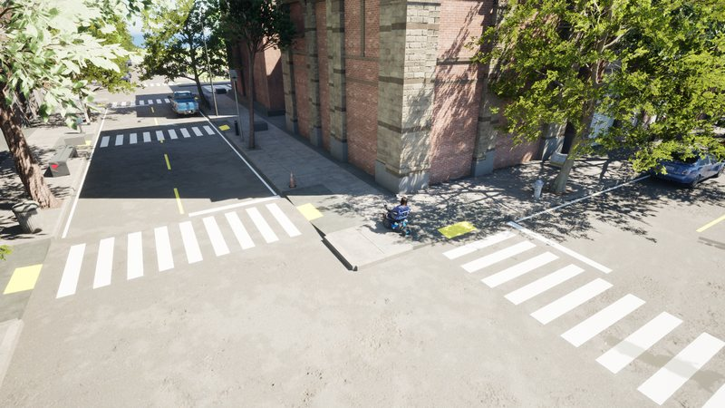<br><sub><b>Downtown</b>: street grid, crosswalks, curb ramps</sub></td>
    <td width="25%" valign="top">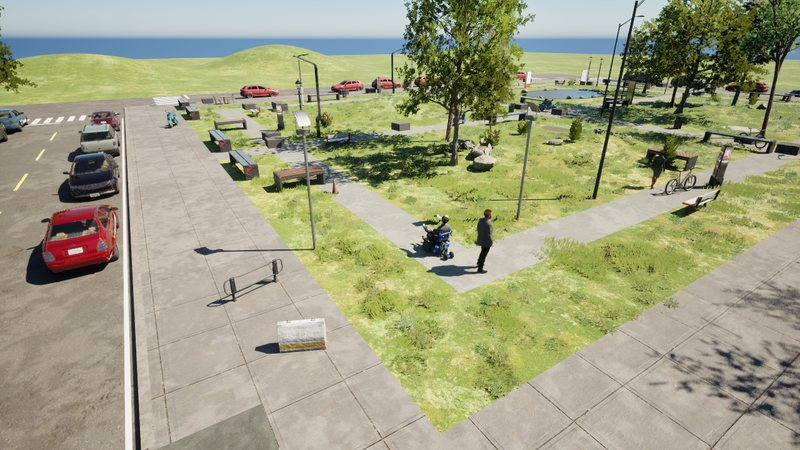<br><sub><b>Main street</b>: street parking, a green square</sub></td>
    <td width="25%" valign="top">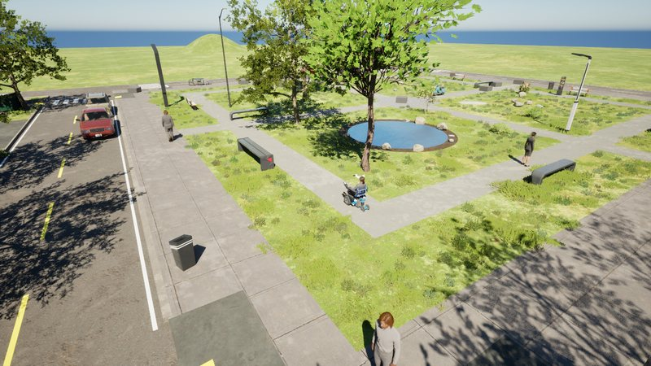<br><sub><b>Suburban</b>: lots, lawns, a pocket park</sub></td>
    <td width="25%" valign="top">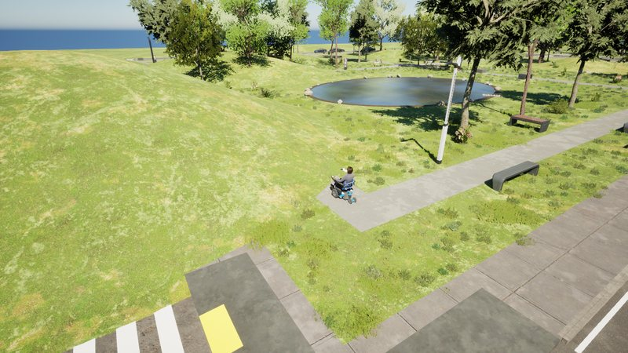<br><sub><b>Park</b>: paths, benches, a pond, hills</sub></td>
  </tr>
  <tr>
    <td width="25%" valign="top">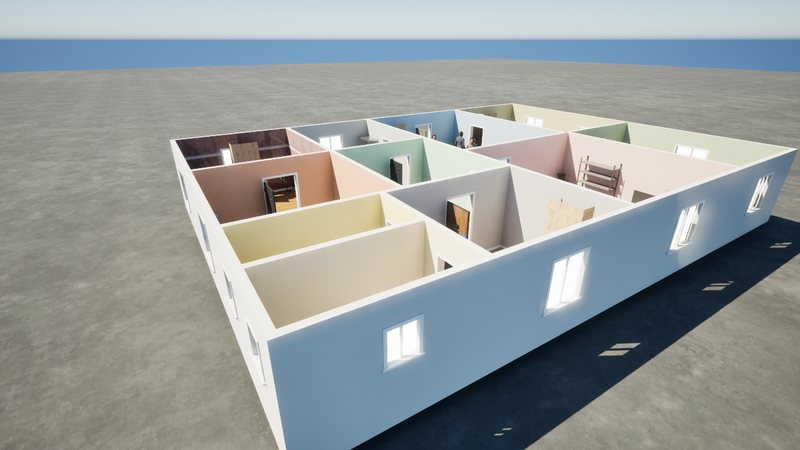<br><sub><b>Home</b>: rooms, doors, thresholds, furniture</sub></td>
    <td width="25%" valign="top">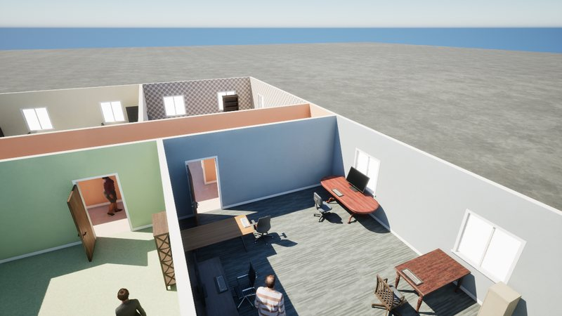<br><sub><b>Office</b>: corridors, offices, desks</sub></td>
    <td width="25%" valign="top">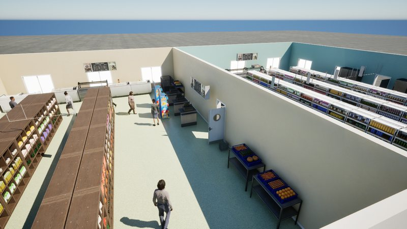<br><sub><b>Store</b>: aisles and shelving</sub></td>
    <td width="25%" valign="top">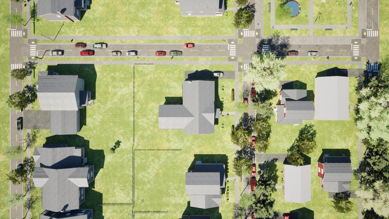<br><sub><b>From above</b>: a suburban block plan</sub></td>
  </tr>
</table>

```
python Scripts/editor_remote_exec.py --file Scripts/worldgen/build_assets.py   # palette, profile, presets, graphs from code
python Scripts/editor_remote_exec.py --file Scripts/worldgen/build_levels.py   # the Map_Gen_* example levels
```

Then open a `/Game/Maps/Gen/Map_Gen_*` level, pick a seed on `WorldGenerator`,
**Regenerate**. The MCP server exposes it as the `RammsWorldGenToolset`
(`worldgen_generate`, `worldgen_randomize`, `worldgen_manifest`, ...), and
ramms-tools as `ramms-worldgen` / `ramms_tools.worldgen` (`ramms-worldgen
generate --preset PRE_Downtown --seed 42`, `ramms-worldgen manifest --issues`,
`ramms-worldgen batch --preset PRE_Park --seeds 1-50 --out data/park`).
See [doc/world_generation.md](doc/world_generation.md) and
`Plugins/RammsWorldGen/README.md`.

## URDF Interoperability

RammsCore ships bidirectional URDF (Unified Robot Description Format)
conversion for interoperability with ROS, MoveIt, PyBullet, MuJoCo and other
robotics tools: export a Physics Asset (e.g. the Kinova Gen3 arm or the MeBot
base) to `<ProjectDir>/urdf/<asset>.urdf`, or import a URDF into a Physics
Asset. The scripts run inside the UE Editor Python console. See the
[RammsCore README](Plugins/RammsCore/README.md#urdf-export--import) for
detailed usage.

## Example Environments

This repository does not include all example environments to keep the
repository size manageable. Additional environments and assets can be
downloaded for free using the **Fab plugin** within Unreal Engine — see
[Download content packs from Fab](#3-download-content-packs-from-fab).

## Developing

### Code Style

Follow the [Epic C++ Coding Standard](https://dev.epicgames.com/documentation/en-us/unreal-engine/epic-cplusplus-coding-standard-for-unreal-engine).

1. Ensure `clang-format` is installed
2. Ensure [pre-commit](https://pre-commit.com) is installed
3. Set up `pre-commit` for this repository:

```console
pre-commit install
```

### Updating Plugin Submodules

Check every plugin out at the commit this repository pins (after a pull):

```bash
git submodule update --init --recursive
```

Move one plugin to the tip of its tracked branch, then commit the new pointer
here (one plugin bump per PR keeps the history readable):

```bash
git submodule update --remote Plugins/RammsCore
git add Plugins/RammsCore
```

### Adding C++ Classes to Plugins

1. Add the class to the appropriate `Public/` or `Private/` directory in the
   plugin's Source folder
2. Update the module's `.Build.cs` if adding new dependencies
3. Regenerate project files via UE Editor or `GenerateProjectFiles.bat`

## License

See LICENSE file for details.

## Contributing

Contributions are welcome! Please fork the repository and submit a pull
request with your changes.

## Contact

For questions or support, please open an issue on GitHub or contact the
maintainers directly.
