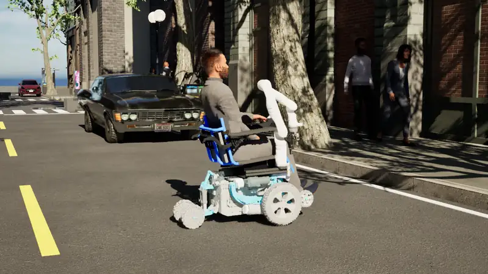
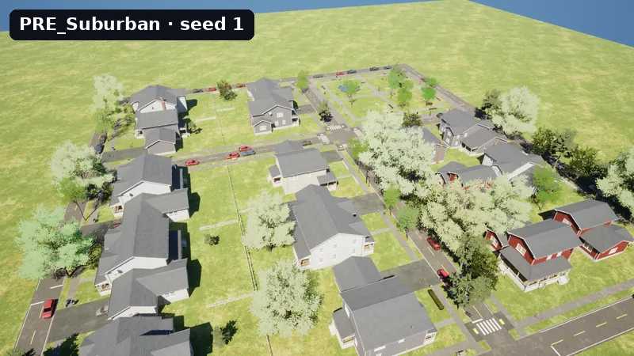
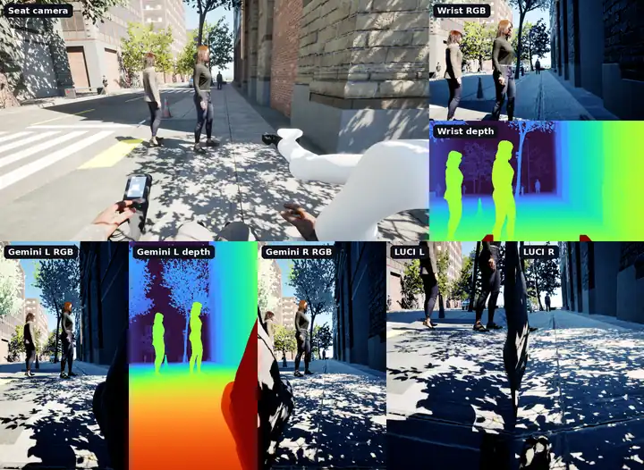
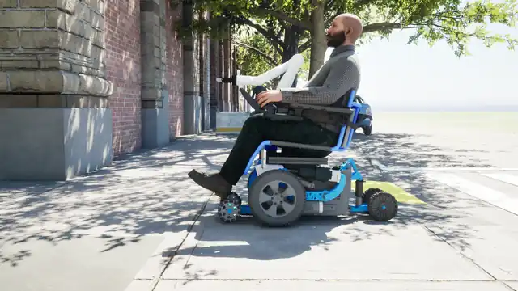
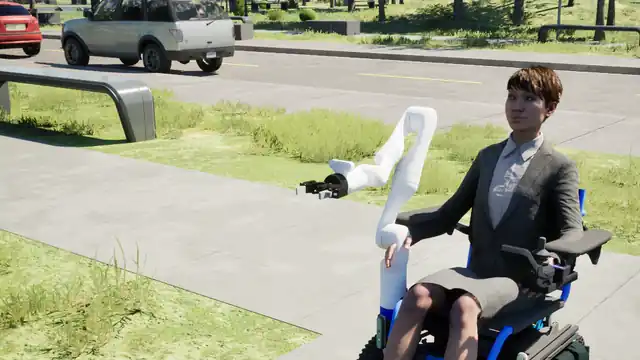
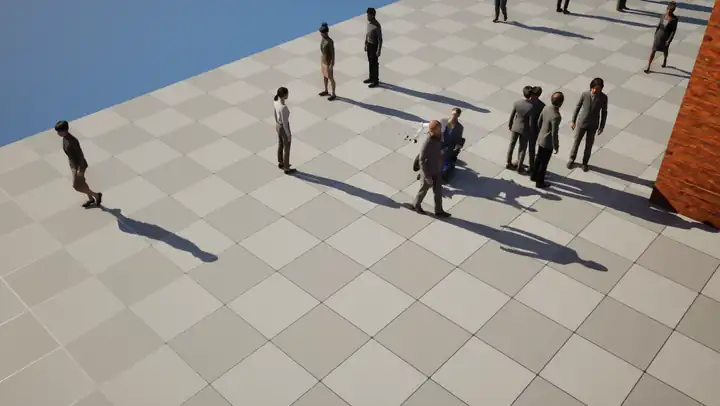
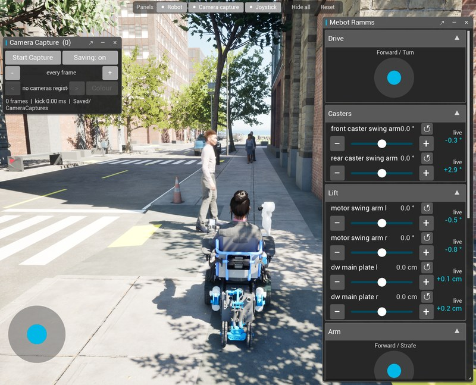
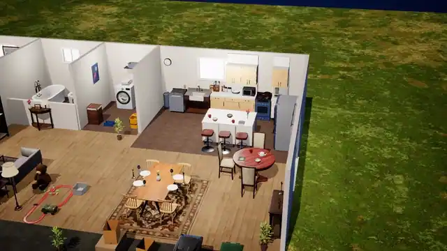
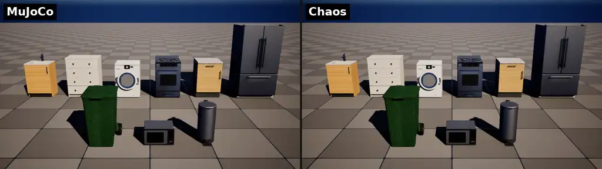

<h1 align="center">RAMMS-Sim</h1>

<p align="center">
  <b>Robotic Assistive Mobility and Manipulation Simulation</b><br>
  A physics-based Unreal Engine 5.8 simulator for wheelchair-mounted robots:
  a powered wheelchair base with a lift and articulated casters, a Kinova Gen3
  arm with a Robotiq 2F-85 gripper, and the sidewalks, curb ramps, parks, homes,
  offices and stores they have to work in.
</p>

<p align="center">
  
  
  
  
</p>

<p align="center">
  
</p>

<p align="center">
  <a href="#highlights">Highlights</a> ·
  <a href="#whats-inside">What's inside</a> ·
  <a href="#quick-start">Quick start</a> ·
  <a href="#documentation">Documentation</a> ·
  <a href="#plugins">Plugins</a> ·
  <a href="#whats-next">What's next</a>
</p>

## Highlights

<table>
  <tr>
    <td width="50%" valign="top">
      <br>
      <b>Procedural, seed-driven worlds.</b> Streets, curb ramps, crosswalks,
      parks, homes, offices and stores built on PCG from a preset and a seed,
      each with a ground-truth accessibility manifest.
    </td>
    <td width="50%" valign="top">
      <br>
      <b>Every camera on the robot.</b> The seat view plus the wrist and Orbbec
      Gemini cameras (the LUCI cameras sit alongside), each with its real
      intrinsics and mounting, rendering RGB, depth, class segmentation and
      motion vectors.
    </td>
  </tr>
  <tr>
    <td width="50%" valign="top">
      <br>
      <b>An articulated base, not a box on wheels.</b> Differential drive,
      front and rear caster swing arms, a lift that raises and tilts the seat
      base, and drive wheels that slide fore and aft, each a motor you can
      command, on a 46-body physics model that holds still on slopes.
    </td>
    <td width="50%" valign="top">
      <br>
      <b>A physics-driven arm and gripper.</b> Kinova Gen3 with DLS, FABRIK and
      CCD inverse kinematics, end-effector teleoperation and a Robotiq 2F-85,
      with link masses from the manufacturer's data.
    </td>
  </tr>
  <tr>
    <td width="50%" valign="top">
      <br>
      <b>People who notice the robot.</b> Mass Entity pedestrians walk lanes
      around the chair, avoid it, turn to look at it and flinch when it comes
      too close, each with their own walk, idle and phone, cup or bag, in test
      plazas and on the generated sidewalks.
    </td>
    <td width="50%" valign="top">
      <br>
      <b>Drive it from anywhere.</b> In-game panels generated from the
      robot's own control surface, keyboard and gamepad, Python over Remote
      Control, a browser over Pixel Streaming, BCI and switch input, or an AI
      assistant over MCP.
    </td>
  </tr>
  <tr>
    <td width="50%" valign="top">
      <br>
      <b>Homes whose doors and drawers open.</b> A furnished showcase home with
      20 articulated SimReady appliances and cabinets (fridge, range, washer,
      vanity, drawers, bins), and hinged doors and a ceiling when it is closed
      up for a robot's sensors.
    </td>
    <td width="50%" valign="top">
      <br>
      <b>One asset, MuJoCo or Chaos.</b> Robots and articulated objects are
      authored once as MJCF and run on either engine, chosen per level or per
      run, under the same controllers.
    </td>
  </tr>
</table>

## What's inside

**Robots and physics**
- **RAMMP Gen1 powered wheelchair base**: differential drive with torque and velocity
  modes, odometry, front/rear caster swing arms, a lift that raises and tilts
  the base, and drive wheels that slide fore and aft for front-, mid- and
  rear-wheel drive. A parking brake brings a stopped chair to
  rest and holds it on ramps.
- **Kinova Gen3 arm and Robotiq 2F-85 gripper**: a skeletal arm on per-joint
  physics constraints; joint, end-effector, velocity and torque control; three IK
  solvers with null-space preferred poses; realistic link masses.
- **One robot model, three physics engines**: every controller drives motors by
  id through `RammsRobotBaseComponent`, which resolves a backend once: Chaos
  skeletal bodies, MuJoCo through
  [UnrealRoboticsLab](https://github.com/rammp-org/UnrealRoboticsLab), or the
  experimental [Newton](https://github.com/newton-physics/newton) worker.
- **A seated person and other robots**: an operator seated in the chair,
  the RAMMP Gen2 lift-drive research platforms (holonomic and linkage), an accessible van with an
  articulated ramp, and an ADA door.

**Sensing**
- **Calibrated cameras**: pixel intrinsics (fx, fy, cx, cy) and reusable sensor
  presets (e.g. RealSense D435) on cameras mounted where the real Orbbec Gemini,
  LUCI and wrist cameras sit, writing 32-bit EXR RGB + depth + motion vectors
  with per-frame JSON metadata, and fine and coarse class segmentation masks.
- **GPU ray-traced range sensors**: time-of-flight (single point like the
  VL53L0X or an NxM grid like the VL53L5CX) and sonar cones traced inline on RT cores, plus an IMU with
  noise, bias and filtering.
- **Streaming out**: the RMSS binary protocol streams RGB, depth, RGB-D, motion
  and point clouds over TCP to Python or ROS tooling.

**Worlds and people**
- **RammsWorldGen**: seed-driven downtown, main-street, suburban, park, home,
  office and store levels on UE 5.8 PCG, with curb ramps, entrances (level,
  stepped, ramped), hazards and a `NonCompliance` dial that breaks features on
  purpose. Every world exports a manifest of routes, clear widths and
  accessibility violations.
- **RammsCrowd**: Mass Entity pedestrians on ZoneGraph lanes that avoid the
  robot and react to it in aware, react and startle zones, animated with
  body-type walk and idle variants, carried props, directional walks played at
  the speed their feet need, head look-at and bump reactions.
- **Articulated interiors**: NVIDIA SimReady cabinets, drawers and appliances
  placed as URLab articulations whose doors and drawers open on MuJoCo or
  Chaos, in generated homes and a furnished showcase home, with hinged doors
  and ceilings for closed-up levels.

**Ways in**
- **Control surface**: a robot describes its controls (`drive.forward`,
  `lift.*`, `arm.*`, `gripper.*`, `camera.*`), and every input source drives
  that description, with arbitration between them.
- **In-game UI**: floating panels, joysticks and sliders built from that
  description, plus camera-capture and status panels.
- **RammsAccess**: alternative-access input (BCI, head mice, eye gaze, switches)
  normalized into one intent stream with a watchdog and e-stop.
- **Remote**: [ramms-tools](https://github.com/rammp-org/ramms-tools) CLIs and
  a Python library over the Remote Control API, Pixel Streaming to any browser
  (WASD and touch), and an in-editor MCP server with a RAMMS toolset for AI
  assistants.

**Scale and testing**
- Headless rendering builds for Linux, cross-compiled from Windows, with a
  container definition for GPU clusters.
- Play-in-Editor suites for the Chaos and MuJoCo bases (drive, turn, lift,
  arm, stopping on a ramp, remote access), camera capture, the seat, teleop and
  Newton, a mini-golf course where a Gen3 putts a free ball under MuJoCo, plus
  C++ automation tests.

Each of these is described in more depth in [Features](doc/features.md).

## Quick start

You need Unreal Engine 5.8, Visual Studio 2022 (Windows) or a C++ toolchain,
CMake, and a GPU with ray tracing; see [Prerequisites](doc/getting_started.md#prerequisites).

```bash
git clone --recursive https://github.com/rammp-org/ramms-sim.git
cd ramms-sim
```

Before the first build, compile URLab's native dependencies (MuJoCo, CoACD,
libzmq) and its ProtoSpec. On Windows:

```powershell
cd Plugins/unreal-robotics-lab/third_party; ./build_all.ps1
cd ../protospec; ./build.ps1
```

On macOS or Linux, run the setup script from the repository root instead,
with `UE_ROOT` pointing at your engine. It defaults to the macOS install path,
so on Linux it has to be set:

```bash
UE_ROOT="/Users/Shared/Epic Games/UE_5.8" Scripts/setup_urlab.sh   # macOS
UE_ROOT="$HOME/UnrealEngine" Scripts/setup_urlab.sh                # Linux: your UE 5.8 root
```

Then claim the free Fab packs the crowd and example maps use (City Sample
Crowds at least), and open `Ramms.uproject` in UE 5.8.

[Getting started](doc/getting_started.md) has each step in full, plus
command-line builds, packaging, Linux cross-compiles and configuration.

## Documentation

| Guide | What's in it |
|-------|--------------|
| [Getting started](doc/getting_started.md) | Prerequisites, installation, the URLab fork, Fab packs, command-line builds and packaging, Linux cross-compiles, repository layout, renderer and game settings, code style and submodule updates |
| [Features](doc/features.md) | The RAMMP Gen1 base, Kinova Gen3 arm, physics backends, van, sensors, camera capture and segmentation, streaming, control surface and input, crowds, world generation and SimReady articulations, URDF |
| [Scripting and remote control](doc/remote_and_scripting.md) | Python Remote Execution, recording runs for video, ramms-tools over the Remote Control API, Pixel Streaming, the MCP server and RAMMS toolset |
| [World generation](doc/world_generation.md) | Presets, seeds, the manifest and the example levels |
| [Pixel Streaming](doc/PIXEL_STREAMING.md) | Launch flags per platform, architecture and troubleshooting |

Design notes and plans in [`doc/`](doc):
[base component and controls](doc/base_component_controls.md),
[robot pawns](doc/robot_pawn.md),
[Chaos physics backend](doc/chaos_physics_backend_plan.md),
[MuJoCo roadmap](doc/mujoco_sim_roadmap.md),
[UI and input refactor](doc/ui_input_refactor_plan.md),
[camera segmentation](doc/camera_segmentation_plan.md),
[parallel simulation](doc/PARALLEL_SIM_PLAN.md),
[Pixel Streaming plan](doc/PIXEL_STREAMING_PLAN.md),
[worldgen MuJoCo export](doc/worldgen_mujoco_export.md),
[controllers extraction](doc/controllers_extraction.md),
[holonomic drive and position pad](doc/holonomic_drive_and_position_pad.md) and
[articulated asset pipeline](doc/dojo_asset_pipeline.md).

## Plugins

Most of the simulator lives in plugins, each a git submodule with its own
repository and a README that documents it in depth:

| Plugin | What it does | Docs |
|--------|--------------|------|
| **RammsCore** | Differential drive, the RAMMP Gen1 controller, the Kinova Gen3 arm and its IK solvers, gripper, ToF / sonar / IMU sensors, GPU ray tracing, URDF import and export | [README](https://github.com/rammp-org/ramms-core#readme) |
| **RammsMujocoSupport** | MuJoCo support classes and content: Gen3 end-effector teleop, gripper articulation, running URLab articulations on Chaos, choosing the engine per level | [README](https://github.com/rammp-org/ramms-mujoco-support#readme) |
| **unreal-robotics-lab** | URLab, our fork: MuJoCo in Unreal with MJCF import, 40+ sensors, ZMQ networking, debug drawing and record/replay | [README](https://github.com/rammp-org/UnrealRoboticsLab/tree/ramms/v0.6.0-beta#readme) |
| **RammsNewtonPhysics** | Experimental Newton worker bridge: a fixed-step subsystem and an articulated-robot API stepped out of process | [README](https://github.com/rammp-org/ramms-newton-physics#readme) |
| **RammsMujocoPhysics** | Experimental MuJoCo integration scaffold for selective external simulation | [README](https://github.com/rammp-org/ramms-mujoco-physics#readme) |
| **RammsHumanPhysics** | Experimental human body physics | [README](https://github.com/rammp-org/ramms-human-physics#readme) |
| **CameraCapture** | Calibrated multi-camera capture: intrinsics, RGB + depth + motion vectors as EXR, segmentation, frustum visualization | [README](https://github.com/finger563/unreal-camera-capture#readme) |
| **RammsStreaming** | The RMSS binary protocol over TCP (port 30030): images, depth, motion vectors and point clouds | [README](https://github.com/rammp-org/ramms-streaming#readme) |
| **RammsControl** | The control-surface model: how a robot describes its controls and how any input source drives them | [README](https://github.com/rammp-org/ramms-control#readme) |
| **RammsUI** | Panels, joysticks, camera widgets, layouts and themes, projection decals | [README](https://github.com/rammp-org/ramms-ui#readme) |
| **RammsAccess** | Alternative-access input (BCI, head mice, eye gaze, switches) as one intent stream | [README](https://github.com/rammp-org/ramms-access#readme) |
| **RammsCrowd** | Mass Entity pedestrians on ZoneGraph lanes that avoid and react to the robot | [README](https://github.com/rammp-org/ramms-crowd#readme) |
| **RammsWorldGen** | Seed-driven streets, parks, homes, offices and stores on PCG, with an accessibility manifest, UrbanVerse and SimReady palettes, hinged doors and ceilings | [README](https://github.com/rammp-org/ramms-worldgen#readme) |
| **RammsAssets** | Meshes and materials: the Gen3 arm, gripper, RAMMP Gen1 base, seat, Orbbec and LUCI cameras | [README](https://github.com/rammp-org/ramms-assets#readme) |
| **RammsPrivateAssets** | Private, optional content (the lift-drive CAD-derived meshes, articulations and test map); skipped by a recursive clone | Private |

The sister repository [ramms-tools](https://github.com/rammp-org/ramms-tools) holds the Python library
and CLIs that drive the sim from outside the editor
([Scripting and remote control](doc/remote_and_scripting.md#ramms-tools-remote-control-api)).


## What's next

Work in progress and planned, with the design notes in [`doc/`](doc):

- **Parallel headless simulation** on SLURM GPU clusters for policy training
  and dataset collection. Linux builds (x86_64 and ARM64) cross-compile from
  Windows and launch headless with `Scripts/run_headless.sh`. Next: a packaged
  instance verified end to end, several instances per node, SLURM templates
  and dataset collection ([plan](doc/PARALLEL_SIM_PLAN.md)).
- **Generated worlds in MuJoCo**: exporting RammsWorldGen curbs, ramps, steps
  and walls into the MuJoCo spec so MuJoCo-driven robots collide with them
  ([design](doc/worldgen_mujoco_export.md)), and Python scene generation for
  MuJoCo episodes ([roadmap](doc/mujoco_sim_roadmap.md), thread 3).
- **Instance segmentation**, and class masks streamed over RMSS, next to the
  class masks CameraCapture writes today
  ([plan](doc/camera_segmentation_plan.md)).
- **Controllers as their own plugin**, `ramms-controllers`; the first step,
  decoupling input from the concrete controllers, is under way
  ([plan](doc/controllers_extraction.md)).
- **Remote HMI over Pixel Streaming** for the rammp-ui operator interface
  ([plan](doc/PIXEL_STREAMING_PLAN.md)), and RammsAccess intents driving the
  physical robot as well as the simulated one.

Recently landed and covered in [Features](doc/features.md): the bases driven
in MuJoCo, a seated occupant in the chair, the RAMMP Gen1 on its own MJCF,
robots and articulated assets on Chaos from the same MJCF, class
segmentation, the holonomic drive and the 5-bar position pad, and
articulated SimReady cabinets, drawers and appliances in generated and
hand-built homes.

## License

See LICENSE file for details.

## Contributing

Contributions are welcome! Please fork the repository and submit a pull
request with your changes. [Developing](doc/getting_started.md#developing)
covers code style, submodule updates and adding C++ classes to plugins.

## Contact

For questions or support, please open an issue on GitHub or contact the
maintainers directly.
