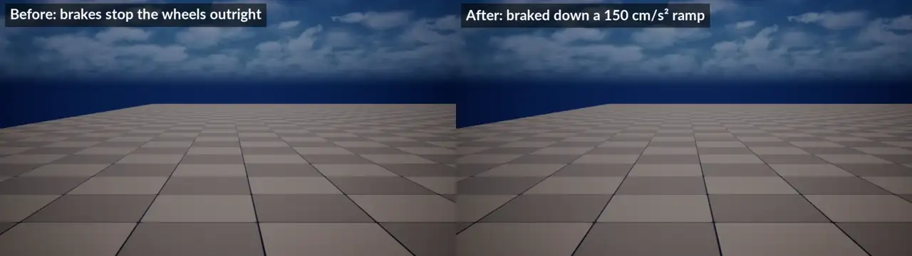
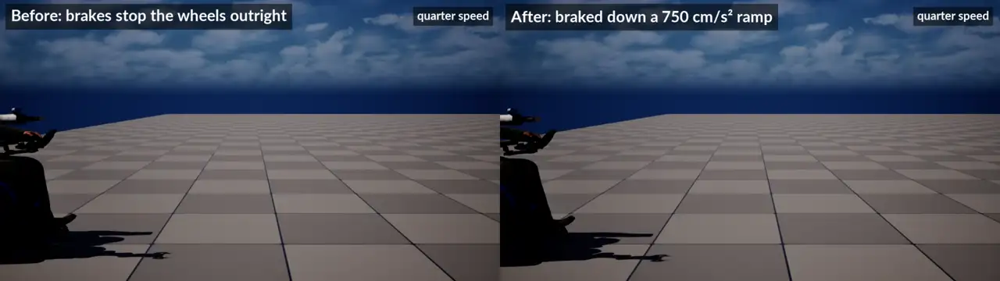
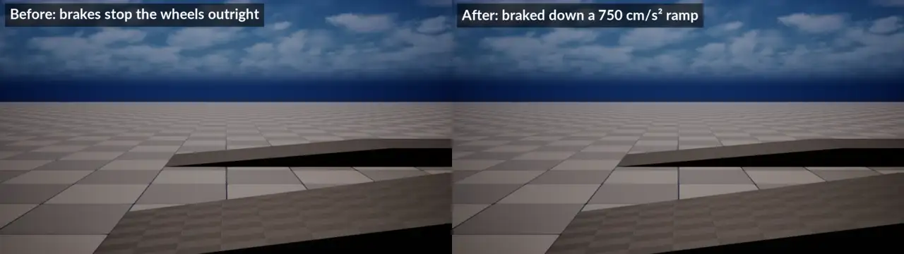
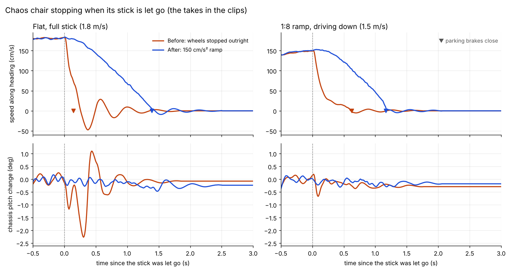

# Base-component PIE tests

Drives the running editor over Python remote execution
(`Scripts/editor_remote_exec.py`) to validate the shared robot base component
on both physics backends. Requires the editor open with Remote Execution on.
The lift-drive assets live in the optional `RammsPrivateAssets` plugin
(`git submodule update --init --checkout Plugins/RammsPrivateAssets`, then
restart the editor); the MuJoCo builders/tests need it, the Chaos chair test
doesn't. `move_private_assets.py` is the one-shot migration that put them there.

- `make_assets.py` — creates the motor / 5-bar DataTables under
  `/Game/Robots/Data`, adds `RobotBase` to `BP_RammpGen1_Ramms`, and builds
  `BP_LiftDriveLinkage_Ramms` (child of the imported articulation) with the
  base, diff-drive and both centre 5-bar controllers. Idempotent.
- `make_input_assets.py` — authors the Enhanced Input assets under
  `/Game/Input/Ramms`: the `IA_Ramms_*` actions, the single `IMC_RammsRobot`
  mapping context (every key, once) and one `URammsControlInputMap` per robot
  family (`DA_RammsInput_LiftDriveLinkage` / `LiftDriveHolonomic` / `RammpGen1`)
  binding actions to control Ids (wildcards such as `motor.*_front_crank`).
  Re-run it to change a key; it overwrites mappings and bindings.
- `make_pawns.py` — makes `BP_LiftDriveLinkage_Ramms` / `BP_LiftDriveHolonomic_Ramms`
  driveable pawns (RobotBase, diff-drive, 5-bar, follow + top-down cameras
  with a RammsRobotCameraComponent, ControlSurface, SimControl, ControlInput
  with the family's input map, AutoPossessPlayer). The legacy polled
  KeyboardTeleop is removed.
  Keys (IMC_RammsRobot): W/S A/D drive (A/D strafe in holonomic mode, Q/E
  turn there), E/Q legs, Y/H T/B Z/X C/V motor
  groups, N camera / Home reset, I/K J/L U/O + arrows + M/. arm, R resync,
  [ ] G gripper, P pause, Backspace reset, / step, 1-7 debug toggles; mouse
  drag orbit and wheel zoom stay on the camera component.
- `make_test_map.py` — `BP_LiftDriveTestGameMode` + rewrites `Map_BaseTest_URL`
  (PlayerStart, GameMode Override, placed articulations removed) so a plain Play
  spawns, possesses and simulates the chosen lift-drive pawn.
- `run_chaos.sh` — PIE on Map_Demo: the Chaos chair drives and turns through
  its **control surface** (`chaos_t1.py` / `chaos_turn.py` / `chaos_stop.py`
  call `SetControl("drive.forward" | "drive.turn")` on the pawn's
  `RammsRobotControlSurfaceComponent`), then its constraint-driven Position
  motors are commanded and read back through the base (`chaos_pos_*.py`),
  the surface's lift axes and source arbitration are checked
  (`control_surface_check.py`), the Kinova arm and gripper are driven through
  `arm.forward` / `gripper.closed` / `arm.resync` (`chaos_arm.py`), the
  RammsUISubsystem registry is checked, Enhanced Input actions are injected
  through `ControlInput` (lift motor group, gripper open / close, arm up —
  `control_input_check.py`), a gamepad is driven at its keys
  (`control_input_check.py pad_axis / pad_key / pad_hold`, `URammsInputTestLibrary`): the
  left stick through its dead zone, reported as `Gamepad`, the twist doing
  nothing on the differential drive, W and the stick combining on the drive
  axes, the right stick Y (down, then up) / triggers / bumpers each held for a fixed stretch of game time
  (released by the editor) and moving the elevators / translators / caster
  arms by their rate's worth since a mark — and the RammpGen1Controller API is
  exercised.
- `make_ramp_map.py` — builds `/Game/Maps/Map_RampTest` from the engine's
  default template: a 1:12 (4.8°, the ADA maximum) and a 1:8 (7.1°) ramp with
  landings, rising along +X, and a PlayerStart on the first one's approach.
  Idempotent (rebuilds the ramps in place).
- `run_ramp.sh` — PIE on Map_RampTest: for each ramp the chair is teleported
  to the approach (`ARammsRobotPawn::TeleportRobot`), driven up through the
  control surface, let go halfway up, and must stay put: no more than 5 cm
  back from its furthest point before it holds and 2 cm either way over the
  next 6 s (`chaos_ramp.py go|check A|B`); then the same driving *down* from
  the landing (`Ad`, `Bd`). It reports the parking brakes' state; on Chaos
  they are what holds it.
- `chaos_brake.py` — how hard the Chaos chair stops when let go. It starts PIE on
  Map_RampTest itself, drives the chair through the control surface (on the flat
  at full and half stick, and down the 1:8 ramp), lets go, and logs its speed,
  chassis pitch and height and the parking brakes each editor tick. It reports
  the peak deceleration (over 100 ms), the time and distance to rest, and how
  far the chassis pitched, and writes the series to `Saved/RammsTests/brake.json`.
  `python Scripts/editor_remote_exec.py --file Scripts/pie_tests/base_component/chaos_brake.py`;
  `unreal._ramms_brake_cases` picks the cases, `unreal._ramms_brake_decel` runs
  them with another `BrakeDeceleration` (0: the wheels stopped outright, as
  before the brake ramp), and `unreal._ramms_brake_frames` records each case
  from the side as PNG frames (the game paused over each capture, so recording
  does not change the stop). The front casters are raised to -30 deg first and
  held there (`unreal._ramms_brake_front_caster`; `None` leaves them down):
  left down, as the chair spawns, they leave it little room to pitch forward,
  and a hard stop looks gentler than it is. Before (left) and after (right),
  casters at -30 deg, at full stick on the flat, the same at quarter speed,
  and down the 1:8 ramp:

  
  
  
  
- `run_mj_full.sh` — PIE on Map_BaseTest_URL with `BP_LiftDriveLinkage_Ramms`:
  points `BP_LiftDriveTestGameMode.DefaultPawnClass` at the linkage pawn for the
  run (unsaved; `mj_restore.py` reloads the game mode from disk afterwards), lets
  the game mode spawn/possess/unpause it, then drives and turns through the
  surface (`mj_drive.py`, `mj_turn.py`), moves the 5-bar legs to the bottom
  and top of the height range the linkage reports (`mj_lift.py`, which fails
  if the surface refuses), lists the surface — drive, linkage, camera, sim and
  the unclaimed crank / wheel motors — and pauses, resumes and resets the
  MuJoCo scene through `sim.pause` / `sim.running` / `sim.reset`
  (`control_surface_check.py`), then repeats drive / linkage height / camera
  next / pause / reset by injecting the Enhanced Input actions (W, Q, N, P,
  Backspace) into `ControlInput` and checks URLab's hotkey handler is off
  (`control_input_check.py`).
- `chaos_reset_pose.py` — puts the chair back at its PlayerStart, at rest;
  `run_chaos.sh` runs it after the turn check so the later sections start
  from the spawn pose.
- `cs_common.py` — the runners' helpers: find the pawn's surface, pause the
  per-tick local input writers, `set_control` that raises when refused.
- `strip_bp_input.py` — removes a robot Blueprint's direct input wiring (key
  events, input-action reads, the per-tick `SetDriveInput` write) via
  `RammsBlueprintCleanupLibrary` (RammsCoreEditor); run once on
  `BP_RammpGen1_Ramms` on 2026-09-15.
- `access_send.py` — host-side sender of ramms-access v1 intent packets (UDP
  JSON: `--drive X Y`, `--ee-lin`, `--ee-ang`, `--event`); `access_check.py`
  asserts the surface's owner (`expect_owner drive.forward Autonomy`).
- `hud_check.py` — the auto-spawned control HUD (ramms-ui) via
  `unreal._ramms_hud_op`: `status | shot | joystick <x> <y> | joystick_release |
  row <id> <value> | action <id> | hold <id> <+|-> | release <id>` — drives
  the panel's rows and the drive joystick the way a touch would.
- `control_input_check.py` — Enhanced Input ops via `unreal._ramms_ci_op`:
  `status | inject <IA name> <x> <y> <z> [hold_s] | expect <id> <min> <max> |
  camera | camera_changed | urlab`. `inject` feeds an action as if its key
  were held (`URammsControlInputComponent::InjectActionByName`).
- `control_surface_check.py` — ad-hoc surface ops via `unreal._ramms_cs_op`:
  `describe | drive | stop | set <id> <v> | release <id> | trigger <id> |
  read <id> | json | arbitration | registry`.

The runners resolve the repo root from their own location, so they work from
any clone. Gotchas: each remote command runs synchronously on the game thread,
so tests are chains of short scripts with local sleeps, run from **bash**; never
`set_editor_property` on live PIE components (use the `Set*` UFUNCTIONs); the
chair's legacy tick re-issues its joystick every frame, so a scripted
command on the chair needs its actor tick disabled first
(`cs_common.quiet_local_input`); and the chair Blueprint takes the arm (teleop
off, so the surface refuses `arm.*` / `gripper.*`) when a `Target`-tagged
button enters its `ArmWorkspaceTrigger`, giving it back seconds later once the
arm retracts (see `doc/robot_pawn.md`) — the gamepad section drives up to one,
so `chaos_t1.py` turns the trigger's overlaps off (`cs_common.quiet_arm_workspace`).
