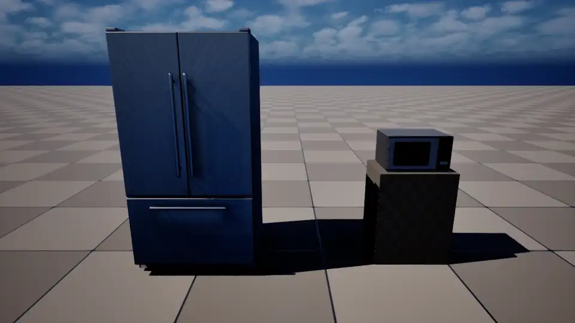
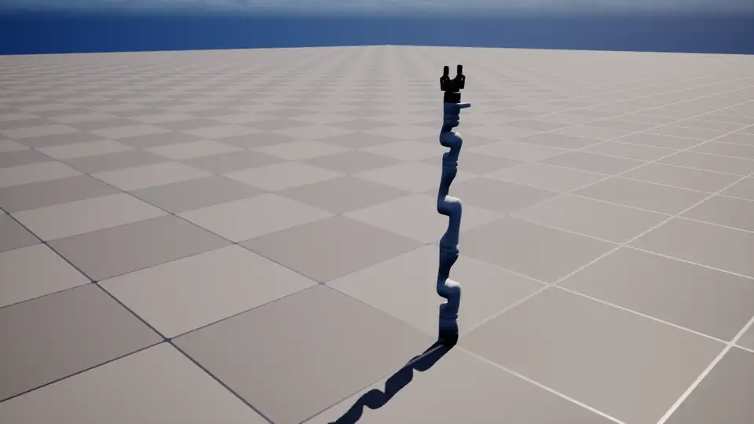

# Chaos articulations

Runs URLab articulations on Chaos through ramms-mujoco-support's `URammsChaosArticulationComponent`,
then compares them with MuJoCo. The plan and the spike behind this are in
`doc/chaos_physics_backend_plan.md`.

```
chaos_map.py   editor: a scratch level with articulations and a camera, and no MuJoCo manager
               (/Game/ChaosProto/Map_ChaosArticulation; don't commit it)
chaos_run.py   editor: PIE; switch every articulation to Chaos and run a generic schedule;
               Saved/ChaosArticulation/<run>.json and <run>_summary.txt
```

## Run

In the editor's Python console:

```python
import unreal; D = unreal.Paths.project_dir() + "Scripts/pie_tests/chaos_articulation/"
exec(open(D + "chaos_map.py").read())
CA_OUT = "run"; exec(open(D + "chaos_run.py").read())   # CA_FRAMES = True also writes frames
```

**What gets placed.** `chaos_map.py` always places the Gen3 + 2F-85 (`/Game/Robots/URL/gen3_2f85_fixed`).
It also places the SimReady refrigerator and microwave and the lift-drive linkage base when this
checkout has them. Pass `CA_ACTORS` to choose your own.

**The schedule.** `chaos_run.py` takes each articulation through these steps:

1. It settles for 1 s.
2. It ramps its actuators to each MJCF keyframe's ctrl, 2 s per keyframe.
3. It pushes every joint no actuator moves for 0.5 s: 2 N·m on a hinge, 10 N on a slide.
4. It runs its torque motors at a quarter of their ctrl range for 2.5 s.

**The comparison.** The same schedule run in MuJoCo gives the comparison below. Those runs used
`mujoco` on the host on the same MJCFs, with no floor except where the model has one.

## Videos

Recorded on Chaos at game time, so they play at real-time speed.

| SimReady refrigerator and microwave | Gen3 + 2F-85 |
|---|---|
|  |  |
| Each joint is pushed open in turn (fridge doors, freezer drawer, microwave door, turntable, release button), then pushed closed; the joints' damping and the button's spring come from the MJCF | Joint-space move to a reach pose, gripper close and open, then back |

## Results (2026-10-28)

Each cell is the joint's maximum over the run, then its value at the end.

**SimReady refrigerator and microwave**

| joint | Chaos | MuJoCo |
|---|---|---|
| fridge `door_1` / `door_2` (rad) | 1.83 / 1.83, stays | 2.10, ends at 2.08 |
| fridge `freezer` / `crisper_1` (m) | 0.120 / 0.124 | 0.125 / 0.114 |
| microwave `door` (rad) | 1.75, ends at 1.74 | 1.79, ends at 1.41 |
| microwave `turntable` / `roller_ring` (rad) | 19.5 / 1.96 | 20.0 / 2.00 |
| microwave `release` button (m) | 0.005, springs back to 0 | 0.010, springs back to 0 |

- Drawers, the turntable and the button agree to within ~10 %.
- MuJoCo's limits are soft, so its doors overshoot the stop and bounce back.

**Gen3 arm, keyframe `home`**

| joint | Chaos | MuJoCo |
|---|---|---|
| `joint_3` (rad) | 3.33 | 3.14 |
| `joint_4` (rad) | −2.33 | −2.27 |
| `joint_1` (rad) | −0.10 to 0.17 | ±0.004 |

- Chaos reaches the pose but overshoots more, and the other joints wobble during large moves.
- The gripper's servos track, but its passive linkage settles on a different branch (see the plan).

**Lift-drive linkage base** (private assets)
- **Stances:** the chassis heights and the tilt match MuJoCo to within ~2 cm and 0.5°. The plan has
  the table.
- **Driving in the mid stance:** 4.3 m against 3.5 m, with a heading change of −0.1° against +0.5°.
  The heading drift of the spike (−13.5°) is gone: the per-body friction material (max-combined, no
  restitution), the MJCF inertia and the physics-rate damping fixed it.
- **Driving in the `fwd` stance** (this script's schedule): 7.0 m with −121° of yaw, against 3.4 m
  with −10°. In that stance MuJoCo's center wheels turn about half as far as its front wheels; Chaos'
  turn further than its fronts, unevenly left to right. So with six wheels down, the two engines
  share the load between the wheels differently. This is open (see the plan, Phase 2).
