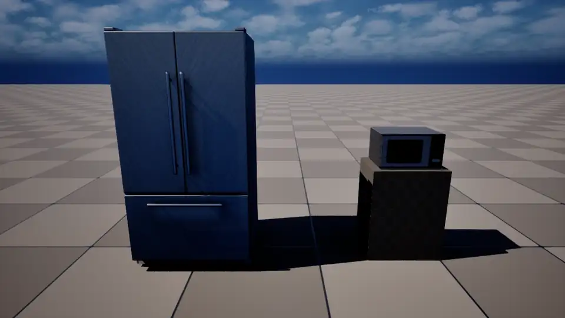
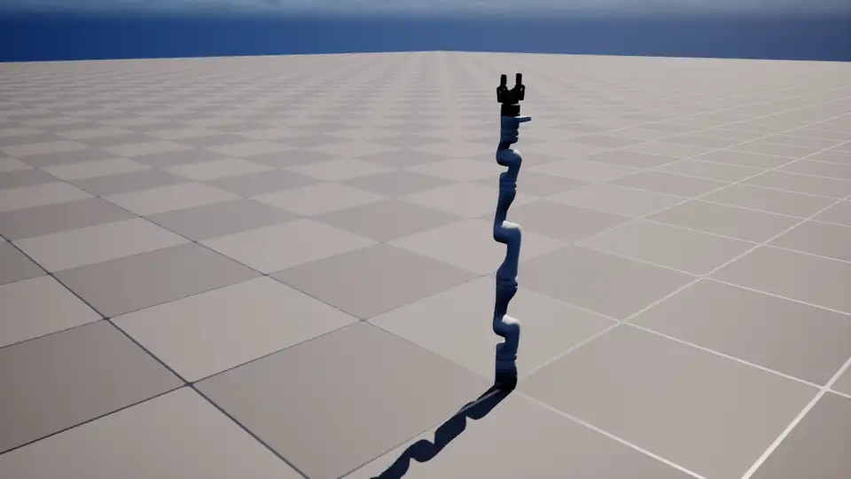
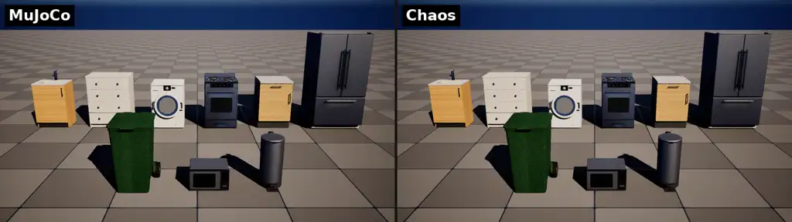
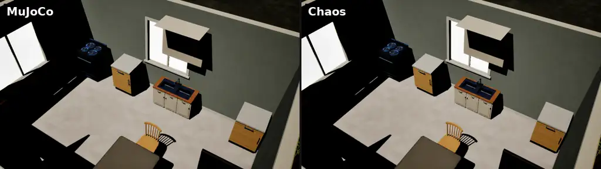

# Chaos articulations

Runs URLab articulations on Chaos through ramms-mujoco-support's `URammsChaosArticulationComponent`,
then compares them with MuJoCo. The plan and the spike behind this are in
`doc/chaos_physics_backend_plan.md`.

```
chaos_map.py   editor: a scratch level with articulations and a camera, and no MuJoCo manager
               (/Game/ChaosProto/Map_ChaosArticulation; don't commit it)
chaos_run.py   editor: PIE; switch every articulation to Chaos and run a generic schedule;
               Saved/ChaosArticulation/<run>.json and <run>_summary.txt
robot_run.py   editor: PIE; drive the robot pawn through its control surface (5-bar heights,
               drive.forward, drive.turn) on whichever engine simulates it, and record it;
               Saved/ChaosArticulation/<run>.json and <run>_summary.txt
simready_showroom.py
               editor: a showroom level of the articulated SimReady assets, with an
               ARammsPhysicsSettings and a camera (/Game/Maps/SimReady/Map_SimReady_Showroom;
               not committed, like the assets)
simready_open.py
               editor: PIE; open and close every door, drawer and lid in the open level with one
               PD controller, on whichever engine the level runs; <run>.json, <run>_summary.txt
               and, with SO_FRAMES, <run>_frames/
```

## Run

In the editor's Python console:

```python
import unreal; D = unreal.Paths.project_dir() + "Scripts/pie_tests/chaos_articulation/"
exec(open(D + "chaos_map.py").read())
CA_OUT = "run"; exec(open(D + "chaos_run.py").read())   # CA_FRAMES = True also writes frames
```

**A robot through its controllers.** `robot_run.py` drives the pawn in the open level through
`URammsRobotControlSurfaceComponent`, as a panel or input map would. The robot base component's motors
go to Chaos when its `Backend` is Chaos (or the articulation carries a
`URammsChaosArticulationComponent`), and to MuJoCo otherwise, so the same script measures both. With
`Backend = Chaos` set on the placed pawn, leave `CR_SWITCH` out:

```python
# Chaos: a level with the pawn and no MuJoCo manager; CR_SWITCH adds the component at runtime
CA_MAP = "/Game/ChaosProto/Map_ChaosRobot"
CA_ACTORS = [("/RammsPrivateAssets/Robots/BP_LiftDriveLinkage_Ramms", (0.0, 0.0, 1.0))]
exec(open(D + "chaos_map.py").read())
CR_OUT = "robot_chaos"; CR_SWITCH = ""; exec(open(D + "robot_run.py").read())

# MuJoCo: the base-component test level spawns and starts the pawn
exec(open(unreal.Paths.project_dir() + "Scripts/pie_tests/base_component/mj_setup.py").read())
CR_OUT = "robot_mujoco"; CR_BEGIN = False; CR_WAIT = 8.0; exec(open(D + "robot_run.py").read())
# then mj_restore.py, as run_mj_full.sh does
```

The schedule is 2 s of settling, each 5-bar linkage to the bottom, top and middle of its height range
(3 s, 3 s, 2 s), `drive.forward` 1 for 3 s, a stop, `drive.turn` 1 for 3 s, and a stop. The clock is the
robot's (`GetSimulationTime`, MuJoCo's when MuJoCo steps it), else the game's.

**What gets placed.** `chaos_map.py` always places the Gen3 + 2F-85 (`/Game/Robots/URL/gen3_2f85_fixed`).
It also places the SimReady refrigerator and microwave and the lift-drive linkage base when this
checkout has them. Pass `CA_ACTORS` to choose your own.

**The schedule.** `chaos_run.py` takes each articulation through these steps:

1. It settles for 1 s.
2. It ramps its actuators to each MJCF keyframe's ctrl, 2 s per keyframe.
3. It pushes every joint no actuator moves for 0.5 s: 2 N·m on a hinge, 10 N on a slide.
4. It runs its torque motors at a quarter of their ctrl range for 2.5 s.

**The comparison.** The same schedule run in MuJoCo gives the comparison below. Those runs used
`mujoco` on the host on the same MJCFs, with no floor except where the model has one.

**One level, either engine.** `simready_showroom.py` places the ten ForgeCAD conversions (RammsWorldGen's
`Tools/simready_mjcf.py`, imported with `SR.import_mjcf`) in a row each; `simready_open.py` then runs the same
controller on whichever engine the level is on, which a run picks with the console variable:

```python
exec(open(D + "simready_showroom.py").read())                                       # the level is on Chaos
unreal.SystemLibrary.execute_console_command(None, "ramms.Physics.Engine MuJoCo")   # or Chaos; "" for the level's own
SO_OUT = "open_mj"; SO_FRAMES = True
SO_MJCF = r"D:/simready/mjcf"   # the folder Tools/simready_mjcf.py wrote (or set RAMMS_SIMREADY_MJCF)
exec(open(D + "simready_open.py").read())
```

The run waits (up to `SO_READY`, 15 s) until every articulation is built on Chaos or the MuJoCo manager runs, and
ends with an `ERROR` line in the summary when a Chaos build failed, the level has no engine for an articulation, or
no articulation has an MJCF in the folder.

Every limited hinge of 30° or more and slide of 8 cm or more (not knobs, dials, buttons, levers, pedals or
wheels) is driven by a PD force (hinges kp 30, kd 6, at most 20 N·m; slides kp 400, kd 80, at most 80 N) toward
80 % of its range over 1.5 s, then back: drawers from 4 s, doors from 5.5 s, so a closing door does not meet a
drawer still out. On MuJoCo the force goes through `UMjBody::ApplyForce`, on Chaos through
`SetJointForce`. With `SO_FRAMES` the run slows the game clock and MuJoCo's sim speed to a quarter
(`SO_SLOMO`), so saving frames does not slow the controller's ticks. `Scripts/worldgen/simready_level.py` generates
a furnished home on the SimReady palette whose cabinets, drawers and range are the same articulations; the same
script runs there.

## Videos

Recorded on Chaos at game time, so they play at real-time speed.

| SimReady refrigerator and microwave | Gen3 + 2F-85 |
|---|---|
|  |  |
| Each joint is pushed open in turn (fridge doors, freezer drawer, microwave door, turntable, release button), then pushed closed; the joints' damping and the button's spring come from the MJCF | Joint-space move to a reach pose, gripper close and open, then back |

| The showroom: the same controller on MuJoCo (left) and Chaos (right) |
|---|
|  |
| A generated home's kitchen (`simready_level.py`), MuJoCo (left) and Chaos (right) |
|  |

## Results: the showroom (2026-11-02)

Each cell is the joint's maximum, then its value at the end; the target is 80 % of the range.

| asset: joint | MuJoCo | Chaos |
|---|---|---|
| refrigerator: `door_1`, `door_2` (target 1.68 rad) | 1.68 → 0.00 | 1.68 → 0.00 |
| refrigerator: `freezer` / crispers (0.36 / 0.24 m) | 0.361 / 0.240 → 0 | 0.360 / 0.240 → 0 |
| kitchen base cabinet: `drawer_1` / `door_1` | 0.378 m / 1.54 rad → 0 | 0.378 m / 1.54 rad → 0 |
| range: `oven_door` (1.26 rad, spring toward closed) | 1.42 → 0.05 | 1.49 → 0.05 |
| range: racks / drawer | 0.240 / 0.320 m → 0 | 0.240 / 0.320 m → 0 |
| washer: `door` (2.51 rad) / `drawer` (0.20 m) | 2.51 → 0 / 0.200 → 0 | 2.51 → 0 / 0.248 → 0.046 |
| chest of drawers: four drawers (0.36 m) | 0.360 → 0 | 0.359 → 0 |
| vanity: `door_1`; microwave: `door`; wheelie bin: lid | 1.54 / 1.40 / 1.54 → 0 | 1.54 / 1.40 / 1.54 → 0 |
| pedal bin: `lid` (1.19 rad) | 1.18 → 0 | 1.08 → 0.20 |

- 18 of the 21 joints agree to within 1 % at their peak and close fully on both. The range door, which a spring
  pulls shut, overshoots its target more on Chaos (1.49 against 1.42 rad); the washer's light detergent drawer
  overshoots to its stop on Chaos; the pedal bin's lid comes to rest ajar there (not yet investigated).
- Getting there took three fixes: `UMjBody::ApplyForce` wrote the torque where MuJoCo reads the force (URLab),
  and held the wrench for one MuJoCo step of the several a frame runs; and a hinged part of a base welded to
  the world (a bin's lid, a washer's door) collided with the base on MuJoCo, which `simready_mjcf.py` now
  `<exclude>`s.

## Results (2026-10-28, Phase 2 defaults)

Each cell is the joint's maximum over the run, then its value at the end. Chaos ran with the
component's defaults: 64 / 8 solver iterations, no joint mass conditioning, the MJCF force ranges as
drive limits. The Phase 1 values (8 / 1 iterations, force limits ×10) are in brackets.

**SimReady refrigerator and microwave**

| joint | Chaos | MuJoCo |
|---|---|---|
| fridge `door_1` / `door_2` (rad) | 2.00 / 2.00, stays (1.75) | 2.10, ends at 2.08 |
| fridge `freezer` / `crisper_1` (m) | 0.115 / 0.123 | 0.125 / 0.114 |
| microwave `door` (rad) | 1.75, ends at 1.74 | 1.79, ends at 1.41 |
| microwave `turntable` / `roller_ring` (rad) | 18.7 / 1.88 | 20.0 / 2.00 |
| microwave `release` button (m) | 0.005, springs back to 0 | 0.010, springs back to 0 |

- Drawers, the turntable and the button agree to within ~10 %.
- MuJoCo's limits are soft, so its doors overshoot the stop and bounce back.

**Gen3 arm, keyframe `home`**

| joint | Chaos | MuJoCo |
|---|---|---|
| `joint_2` (rad) | 0.274 (0.347) | 0.270 |
| `joint_3` (rad) | 3.16 (3.33) | 3.14 |
| `joint_4` (rad) | −2.28 (−2.33) | −2.27 |
| `joint_1` (rad), not commanded | −0.005 to 0.023 (−0.10 to 0.17) | ±0.004 |

- Chaos now reaches the pose with little overshoot; the Phase 1 wobble was the solver, not the gains.
- The gripper's servos track, but its passive linkage settles on a different branch (see the plan).

**Lift-drive linkage base** (private assets)
- **Driving in the `fwd` stance** (this script's schedule): 3.5 m with +1° of yaw, against MuJoCo's
  3.4 m with −10° (7.0 m with −121° in Phase 1). The six-wheel case was the solver: with 8 / 1
  iterations the stance servos sagged, and the wheels shared the load unevenly.
- **Driving in the mid stance** (Phase 1 settings): 4.3 m against 3.5 m, with a heading change of
  −0.1° against +0.5°.
- **Through its controllers** (`robot_run.py`, the linkage pawn):

| | MuJoCo | Chaos |
|---|---|---|
| center linkages to the bottom (−14.9 cm) | −14.9 cm; chassis up 25.3 cm | −14.9 cm; up 25.2 cm |
| to the top (19 cm asked) | stops at 13.7 cm | 15.7–16.3 cm |
| to the middle (2.0 cm) | 2.2 cm; chassis 10.5 cm up | 2.7 cm; 9.6 cm |
| `drive.forward` 1, 3 s | 1.42 m/s, heading +9° | 1.20 m/s, heading +12° |
| stop | coasts (wheels still at 10 rad/s 1 s later) | parked by the brake in 0.3 s |
| `drive.turn` 1, 3 s | 188°/s | 308°/s |
| idle between commands | holds | holds |
| editor frame rate | 56 fps | 100 fps |

  The turn is 1.6× faster and straight driving 15 % slower on Chaos; in both engines the rear wheels
  skid. That is open (see the plan).
