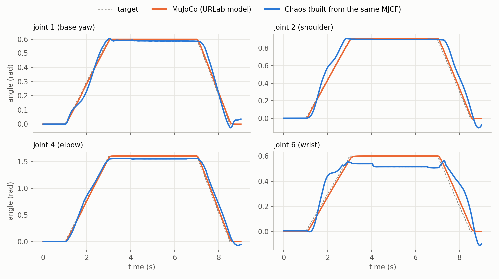
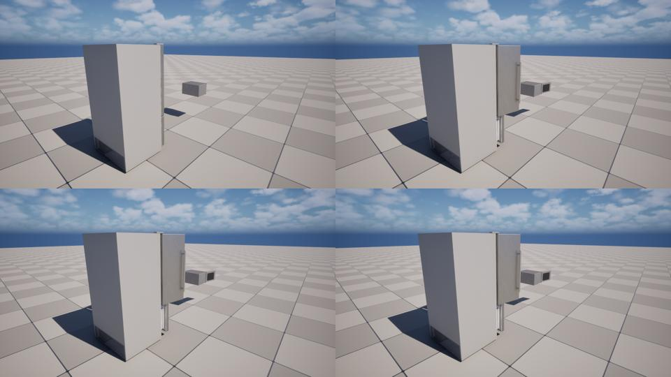

# Chaos as a physics backend for MuJoCo-described robots and objects

Status: **Phase 1 built** (2026-10-28): ramms-mujoco-support's `URammsChaosArticulationComponent` (see
"Phase 1 status" below and `Scripts/pie_tests/chaos_articulation/`). The spike that preceded it is in
`Scripts/chaos_spike/`.

The question was whether the robots and articulated objects RAMMS describes in MJCF (through URLab) can
also run on Chaos, so users choose the engine that fits their application and their content. Matching
MuJoCo exactly is not the goal. The goal is one robot or object definition that runs on either engine:
- RAMMS' controllers, sensors and UI work unchanged.
- On Chaos, the robot or object interacts natively with the user's existing Chaos content.

## Decisions (2026-10-28)

1. **Priority on Chaos:**
   1. base and seat motions (stance changes, lift, tilt, driving) and SimReady articulated objects
   2. grasping
   3. the arm
2. **Grasping on Chaos uses a grasp assist.** Chaos grasping serves teleop and data collection, not
   controller development or high-fidelity manipulation, so a clearly labelled assist is the right tool.
3. **Two-way coupling between engines** (a MuJoCo robot with Chaos-only props) is a future item.
4. **The hand-authored skeletal `BP_Mebot_Ramms` is deprecated** once the generated Chaos robot covers
   it: first it stops being the default, then it is removed.

## Short answer

**Feasible.** Every model below was built in Chaos from its compiled MJCF with no hand authoring. The
results, compared with MuJoCo on the same commands:

| model | what the spike ran | Chaos against MuJoCo |
|---|---|---|
| Lift-drive linkage base: 27 hinges, 6 closed loops, 114 kg | settle, then stances mid → full → tilt → mid, then drive on equal wheel torques | **Stances:** chassis height 7.8 / 21.3 cm against 9.7 / 22.4 cm, tilt 14.3° against 14.8°. Needs the drive-force calibration below. **Driving:** 3.8 m against 3.5 m in 2.5 s, 13.5° of yaw drift against 0.5° |
| SimReady refrigerator: 2 hinged doors, 3 drawers | push every joint open for 0.5 s, then coast | Doors and drawers swing and slide within their ranges. Joint damping is not applied yet (gotcha 7), so drawers run to their stops |
| SimReady microwave: door, turntable, roller ring, sprung button | same | Door stops at its limit; the turntable spins freely; the button's spring is not applied yet (gotcha 7) |
| Kinova Gen3 + Robotiq 2F-85: 15 hinges, tendon gripper with 2 loops | joint-space moves, then a grasp-and-tip | **Arm:** 0.01–0.08 rad RMS, over two runs. **Gripper:** closes, loops hold to under 0.04 mm. **Grasp:** held in MuJoCo (1.6 mm slip), dropped by Chaos in 4 of 4 runs |

**What works:** loop closure, servo stances, wheel driving, hinge and slide joints, and arm tracking.

**What needs work:** a few rules the builder has to apply (the gotchas below); passive joint damping
and springs; and grasping. Grasping now gets an assist rather than fidelity work.

## What exists today

- **Two robots, two physics paths.**
  - `BP_Mebot_Ramms` runs on Chaos. The chair, arm and gripper are skeletal meshes with hand-authored
    physics assets, and the URDF importer (`Plugins/RammsCore/Content/Python/urdf/`) writes limits,
    masses and inertia into them.
  - `BP_Mebot_Mujoco` and the lift-drive bases run on URLab's MuJoCo.
  - The link masses of the two paths are kept equal by hand (`doc/robot_pawn.md`).
- **The actuation seam already exists.** Controllers command motors by id through
  `IRammsActuationBackend` (`RammsActuationBackend.h`). `URammsRobotBaseComponent` picks the
  Chaos-skeletal backend (RammsCore) or the MuJoCo one (RammsMujocoSupport, through the registry). The
  Chaos backend has three gaps:
  - A torque motor is an acceleration change ×100, not N·m.
  - Velocity motors are ignored.
  - It only knows skeletal physics-asset constraints.
- **URLab's model is a component tree.** Each MJCF element is a `UMjNodeComponent`. Compiling it
  produces `mjModel`, with every default resolved and every body's mass, inertia, convex mesh, joint
  axis, actuator gain and keyframe worked out.
- **URLab already supports other solvers.** `UMjPhysicsEngine::CustomStepHandler` replaces `mj_step`,
  and RammsNewtonPhysics uses it. The `Puppet` step mode takes pushed state rather than stepping. After
  either one, `mj_forward` keeps URLab's sensors, recording and bridge consistent.
- **The 2026-09-11 roadmap (`doc/mujoco_sim_roadmap.md`) set Chaos aside for MuJoCo.** This plan brings
  Chaos back as a user-selectable option, not a replacement.

## What Chaos offers (UE 5.8, from the engine headers)

- **Rigid bodies with maximal-coordinate joints.** There is no reduced-coordinate articulation solver.
- **Joint settings:**
  - per-axis limits, including soft limits
  - linear and angular position and velocity drives with a max force, in force or acceleration mode
  - projection, shock propagation, mass conditioning and a linear joint solver
    (`PBDJointConstraintTypes.h`)
- **Project settings:** async physics at a fixed 10 ms step, 16 position and 8 velocity iterations,
  enhanced determinism.
- **Plugins that might be useful later:**
  - Physics Control (1.0)
  - ImmediatePhysics (a private Chaos simulation you step yourself)
  - Control Rig Physics (beta)
  - Chaos Rigid Asset (experimental)

## Options

| | A. Chaos bodies in the world, built from the compiled model *(chosen)* | B. Chaos stepper behind URLab (like Newton) | C. Offline export to skeletal mesh + physics asset |
|---|---|---|---|
| How | At BeginPlay, a component builds Chaos bodies and constraints from `mjModel` in the world's physics scene and moves URLab's visuals onto them | `CustomStepHandler` steps an ImmediatePhysics simulation at the MJCF timestep | An editor tool writes a skinned mesh and physics asset from the MJCF |
| Interacts with the user's Chaos content | **Yes**: same scene | No | Yes |
| URLab sensors, bridge, recording | Through a puppet-style state push (later phase) | Free | No |
| One source of truth | Yes | Yes | No: a generated copy |

## Mapping MJCF to Chaos

| MJCF (compiled) | Chaos | Notes |
|---|---|---|
| body with a joint, or free | simulated body | mass from `body_mass` |
| body with no joint | welded to its parent | |
| moving body with no collision geom | a small body at its centre of mass | the microwave's roller ring |
| geom sphere / capsule / box | sphere / capsule / box element | exact |
| geom mesh | convex element | MuJoCo collides meshes as their convex hull. Pass MuJoCo's hull through; the spike re-hulled with V-HACD at 32 vertices, which is looser |
| geom cylinder | convex polygon | no Chaos cylinder. The lift-drive chassis sat 1.2 cm low on the spike's coarse 16-sided wheels; use more sides |
| hinge | constraint: X axis = joint axis (pseudovector: (−x, y, −z) in Unreal's frame), twist free or limited, swing locked | asymmetric `range`: `AngularRotationOffset` at mid-range, with targets less mid-range |
| slide | linear X along the axis (a true vector: (x, −y, z)), the rest locked | asymmetric `range`: build the body at mid-range, then move it back once the constraint has initialised (gotcha 6) |
| `damping`, `stiffness`/`springref`, `frictionloss` | physics-rate forces in the backend | constraint drives did not apply them (gotcha 7) |
| `armature` | none | add to the child's inertia if needed |
| `<position>` / `<general>` servo | position + velocity drive, force mode | stiffness = kp·10⁴, damping = kv·10⁴; max force needs calibrating (gotcha 5) |
| `<motor>` | equal and opposite torques on child and parent, at the physics rate | the spike applied them on the game thread |
| fixed tendon | per-joint drives with coefficient-scaled gains | |
| spatial tendon, `joint` equality, `polycoef` | backend-computed, or dropped | |
| `connect` | point constraint (angular free) | held to 0.03 mm on the base and 0.04 mm on the gripper |
| `weld` | locked constraint, or a kinematic target for mocap welds | |
| contype / conaffinity / exclude / parent filter | self-collision rules | required (gotcha 1) |
| friction | physical material | MuJoCo takes the max of the pair (or the geom with priority); Chaos averages by default |
| torsional / rolling friction, `solref`/`solimp` | none | Chaos limits and contacts are hard: doors stop at their limit, while MuJoCo's soft limits bounce them back |
| keyframes | stance presets | the base's low / mid / full / tilt |

## The spike

`Scripts/chaos_spike/`:
- `mjcf_chaos_export.py` compiles an MJCF with MuJoCo and writes, in Unreal's frame:
  - bodies with their collision hulls
  - joints
  - actuators (servos, motors, tendon couplings)
  - connects
  - keyframes
- `build_chaos_proto.py` builds that in a scratch level: a hull mesh and actor per body, a constraint
  per joint and connect, and drives.
- `chaos_pie.py` runs one of `traj.py`'s schedules in PIE (`arm`, `grasp`, `base` or `object`) and
  measures every joint from body poses.
- `mj_run.py` runs the same schedule in MuJoCo.

### Base (lift-drive linkage)

Stances are reached by ramping the servo ctrls between the MJCF's keyframes over 2 s each. Drive-force
limit ×10 (gotcha 5).

| time | phase | Chaos chassis: height (cm), roll (°) | MuJoCo |
|---|---|---|---|
| 0.9 s | settled at `qpos0` | −1.2, 0.0 | 0.0, 0.0 |
| 2.9 s | mid | 7.8, 0.0 | 9.7, 0.1 |
| 4.9 s | full | 21.3, 0.0 | 22.4, 0.0 |
| 6.9 s | tilt | 12.3, 14.3 | 14.0, 14.8 |
| 8.9 s | back to mid | 9.0, 1.4 | 10.1, 0.9 |
| 9.5–12 s | 8 N·m on every wheel | 3.84 m travelled, yaw −13.5° | 3.51 m, yaw +0.5° |

The constant ~1.2 cm offset is the coarse wheel polygon. MuJoCo also yaws about 7° while changing
stance (wheel scrub); Chaos barely does.

### Arm (Gen3 + 2F-85)

| joint | RMS vs MuJoCo, run 1 / run 2 | at 6 s, Chaos (run 1) | at 6 s, MuJoCo |
|---|---|---|---|
| joint_1 | 0.025 / 0.011 | 0.589 | 0.600 |
| joint_2 | 0.069 / 0.014 | 0.901 | 0.911 |
| joint_4 | 0.058 / 0.044 | 1.550 | 1.603 |
| joint_6 | 0.084 / 0.064 | 0.515 | 0.600 |
| joint_7 | 0.030 / 0.023 | 0.847 | 0.800 |

(radians)

The gains are MuJoCo's, copied 1:1, and Chaos runs at 100 Hz against MuJoCo's 500 Hz. Runs vary
because the spike sets targets and reads angles on the game thread against async physics. The
remaining 0.05–0.09 rad steady-state offsets on joints 4 and 6 are the first tuning item.

**Gripper.** It closes, and its loops hold. Its passive second degree of freedom lands on either branch
from run to run: in run 2 the left finger matched MuJoCo's closed pose and the right one did not.

**Grasp.** MuJoCo holds the box. Chaos dropped it in 4 of 4 runs. Per decision 2, Chaos grasping gets an
assist rather than this fidelity work.

### Objects (SimReady refrigerator and microwave)

Each joint is pushed open for 0.5 s with a generalized force scaled to its moving body's mass:

- **Fridge doors:** reach their 2.09 rad stop in both engines. MuJoCo's soft limit bounces them back
  to 1.57 rad.
- **Freezer drawer:** 0.37 m at 1 s against MuJoCo's 0.40 m.
- **Crisper drawers:** run to their 0.30 m stop in Chaos, against 0.17 m (damped) in MuJoCo.
- **Microwave turntable and roller ring:** spin faster in Chaos.
- **Microwave release button:** does not spring back in Chaos.

The last three all come from the same missing passive damping and stiffness (gotcha 7).

### Gotchas: each one is a rule for the builder

1. **Self-collision has to follow MuJoCo's rules.** With every part colliding, the arm came apart before
   the run started; the spike's looser hulls most likely overlapped at `qpos0`. Apply MuJoCo's
   parent/child filter, `<exclude>`s and contype/conaffinity. The spike makes the parts ignore one
   another, as `bApplySelfCollisionChannel` does.
2. **A drive target does not wake a sleeping body.** Wake on every command, or keep robot bodies awake.
3. **Use force mode (`bAccelerationMode` off)** so gains carry over physically (N·m ×10⁴; N/m and N·s/m
   are already kg/s² and kg/s).
4. **Asymmetric hinge limits need `AngularRotationOffset`,** and every target then has mid-range
   subtracted. Without that, the gripper's drivers rested at 0.4 rad and its linkage folded into the
   other branch.
5. **Drive max force does not carry over 1:1.** With the MJCF's 207 N·m limit converted (2.07 × 10⁶), the
   base's stance servos did not move at all, although MuJoCo holds the stances with 10–30 N·m. ×10 was
   enough, and so was unlimited. Calibrate this (or apply the limit in the backend) rather than copying
   it.
6. **Slides:**
   - The three linear axes share one limit size, so lock Y and Z before sizing X; otherwise the slide is
     locked.
   - A slide's axis is a true vector, unlike a hinge's.
   - Linear limits are symmetric and the frames can't be moved after init. Build the body at mid-range
     and move it back to `q = 0` once the constraint has initialised.
7. **Passive joint damping and springs did not take effect as constraint drives.** The drives were set
   up as intended (velocity drive and/or position drive, force mode, read back in the editor), and an
   unlimited max force didn't change it. Apply `damping`, `stiffness` and `frictionloss` as forces in the
   backend's physics-rate callback, which motors need anyway.
8. **The game mode:** test levels need a neutral game mode, or the project default spawns the MeBot.

## Gaps and risks

1. **Grasp fidelity.** Decided: an assist, not fidelity work.
2. **Mass ratios.**
   - The base's 63 kg chassis on 0.4–1.5 kg links was fine.
   - The rollers variant of the holonomic base has 17 g rollers (138 hinges) and is the stress case.
     Levers: mass conditioning, projection, mass and inertia floors, or collapsing rollers into a
     friction-anisotropic wheel.
3. **MJCF features with no Chaos equivalent:**
   - joint equalities, `polycoef`, spatial tendons
   - `armature`, `frictionloss`
   - soft contacts and soft limits
   - `condim` 4/6
   Each is approximated in the backend or documented as a divergence.
4. **Rate and latency.** Chaos runs at the project's 10 ms step, and commands from the game thread land
   up to one step late. Motors and passive forces belong in an async physics callback.
5. **Wheels.** Use enough cylinder sides, or the chair's existing wheel treatment. Driving yaw drift
   differs: 13.5° against 0.5° over 3.8 m.
6. **URLab features tied to `mjData`** (sensors, recording, bridge, gym env) need the state mirror.

## Phase 1 status (2026-10-28)

`URammsChaosArticulationComponent` (ramms-mujoco-support) is the builder. Add it to an `AMjArticulation`,
or call `SwitchToChaos(Actor, Keyframe)` at runtime.

**How it builds.** It compiles the articulation's own spec with MuJoCo (a model compiler only, never
stepped), then builds from `mjModel`:
- runtime bodies with exact primitives and cooked convex hulls
- MJCF mass, centre of mass and inertia, with welded bodies combined and hinge armature added
- a max-combined, non-bouncing physical material per body
- constraints whose child frames centre asymmetric ranges (no build-at-mid-range trick)
- connect and weld loop closures
- MuJoCo's self-collision filtering
- force-mode servo drives
- an `ISimCallbackObject` that applies motors, joint damping, stiffness and friction loss at the
  physics rate

URLab's body components (and the visuals under them) follow the Chaos bodies.

**Spike gotchas.** Gotchas 1–4, 6 and 7 are now rules in the builder. Gotcha 5 was
`ServoForceLimitScale` (default 10×) until Phase 2 found its cause (see below). The game mode
(gotcha 8) is up to the level.

**Results, against MuJoCo on the same commands.** The tables are in
`Scripts/pie_tests/chaos_articulation/README.md`.

| | Result |
|---|---|
| SimReady fridge and microwave | doors, drawers, turntable and the sprung release button agree with MuJoCo to within ~10 % in travel. Damping and springs now work, through the callback. Doors stop at their limit rather than bouncing |
| Lift-drive base, stances | settled −0.7 cm (MuJoCo 0); mid stance 8.1 cm (9.7); full 21.6 cm (22.4); tilt 14.6° (14.8°) |
| Lift-drive base, driving in the mid stance | **heading drift: −0.1° against MuJoCo's +0.5°.** The spike drifted −13.5°. The fix was the per-body MJCF friction (combined by max) with no restitution, the MJCF inertia and the physics-rate wheel damping. It still travels 4.3 m against 3.5 m. The wheels roll without slipping in both engines, so the gap is in acceleration against damping, not traction |
| Lift-drive base, driving in the `fwd` stance | 7.0 m and −121° of yaw, against 3.4 m and −10°. With all six wheels down, Chaos loads the center wheels more and unevenly. Fixed in Phase 2 (3.5 m, +1°) |
| Gen3 arm | joint tracking as in the spike (0.01–0.09 rad RMS). Large keyframe moves overshoot (3.33 against 3.14 rad) |

**Not yet:**
- slide and velocity-servo drives are untested (no model in hand uses them)
- ball joints and welds between moving bodies are untested
- the ~330 collision-only constraints the lift-drive base needs for MuJoCo's filtering could become
  Chaos ignore-collision pairs (done in Phase 2 for models where no two parts can collide)
- packaged builds need runtime convex cooking

## Phase 2 status (2026-10-28)

**Robots drive on Chaos through their own controllers.** RammsMujocoSupport's registered actuation
backend now drives a URLab articulation on whichever engine simulates it: while the articulation
carries an active `URammsChaosArticulationComponent` (in its Blueprint, or added by `SwitchToChaos` at
runtime), the robot base component's motors go to `FRammsChaosArticulationBackend`. The 5-bar linkage
controllers, the drive controllers, the control surface and the input maps work unchanged. RammsCore's
API is untouched.

| `IRammsActuationBackend` | on Chaos |
|---|---|
| motor ids | MJCF actuator names, as on MuJoCo |
| `GetValue` / `GetVelocity` | the actuator's joint from the latest physics step, not the interpolated game-thread transforms |
| `SetVelocityDrive` | the joint constraint's velocity drive is the P term (solved implicitly); the integral moves its target once a frame; the drive's force limit clamps the sum |
| `SetMotorBrake` | the joint constraint holds a torque motor's joint, up to its torque |
| `SimulatesMotorJoint` | false for torque motors, so the drive controllers park with the brake. Their own torque hold on the wheel angle, closed once a game frame, rang against Chaos and drifted the robot |
| `ReleaseMotor`, `GetMotorTransform` | a servo's drives off until its next command; the joint's body |

**Gotcha 5 was the solver, not the limit.** A drive is only as stiff as Chaos' iterations let it
converge along a chain. Measured on the Gen3 (shoulder sag under gravity at `home`; a joint_1 step of
1.5 rad, saturated at the MJCF's 105 N·m):

| Chaos settings | shoulder sag | step: peak / settled / time to 90 % |
|---|---|---|
| MuJoCo | 0.007 rad | 1.50 / 1.50 rad / 0.15 s |
| project default (8 / 1 iterations), mass conditioning on | 0.072 | 1.80 / 1.45 / 0.32 |
| same, kp ×10 | 0.067 | 1.80 / 1.42 / 0.28 |
| 32 / 4 | 0.035 | 1.72 / 1.47 / 0.22 |
| 8 / 1, mass conditioning off | 0.039 | 1.74 / 1.48 / 0.22 |
| 32 / 4, off | 0.018 | 1.65 / 1.51 / 0.20 |
| **64 / 8, off (the new default)** | **0.010** | **1.58 / 1.50 / 0.16** |

The force limit is now the MJCF's force range as is (`ServoForceLimitScale` 1). With these defaults
the arm reaches its keyframes without the Phase 1 overshoot, the fridge doors open within 5 % of
MuJoCo's travel, and the `fwd`-stance six-wheel drive goes 3.5 m with +1° of yaw against MuJoCo's
3.4 m and −10° (it was 7.0 m and −121°). Per-run tables are in
`Scripts/pie_tests/chaos_articulation/README.md`.

**Also fixed on the way:**
- Self-collision: when MuJoCo's rules leave no pair of parts that can collide (the usual robot MJCF:
  contype 1, conaffinity 0), the parts ignore each other on the RobotSelf channel instead of getting a
  collision-only constraint per pair. The lift-drive base had 330 of them; with stiff drives they
  spun it in place.
- URLab's components get no collision on Chaos. Moving their query shapes every frame cost ~40 ms
  on the lift-drive base (19 → 100 fps).

**The lift-drive linkage pawn through its control surface** (`robot_run.py`), against MuJoCo: the
linkage heights match to within 0.5 cm except at the top, where MuJoCo stops at 13.7 cm and Chaos goes to
16 cm; the chassis heights to within 1 cm; the robot holds still between commands on both. Driving
straight, Chaos is 15 % slower (1.20 against 1.42 m/s) with the same heading drift (+12° against
+9°); turning in place it is 1.6× faster (308 against 188°/s). On a stop Chaos parks on the brake in
0.3 s while MuJoCo coasts. The holonomic pawn runs on Chaos too, but its MuJoCo reference turns 190°
while driving "straight", so there is no comparison yet.

**Open:**
- turning and straight-line speed (contact and scrub: the rear wheels skid in both engines)
- the velocity-loop path is checked with a direct test only; no controller on these robots uses
  `SetMotorVelocityCommand`
- the 5-bar's top-of-range stop (MuJoCo's soft limit or a contact; Chaos' is hard)
- a robot Blueprint variant with the component, so a user picks the engine without `SwitchToChaos`.
  The base component's `Backend = Chaos` still means the skeletal backend; making it select this one
  needs a RammsCore registry entry (a public API change)

## Plan, in the decided order

**Phase 1: a Chaos build of a URLab articulation** (C++, RammsMujocoSupport):
- `URammsChaosArticulationComponent` builds Chaos bodies and constraints from the compiled `mjModel`
  and reparents URLab's visuals.
- A backend choice (MuJoCo / Chaos) on the articulation.
- Gotchas 1–6 are applied as rules.
- First targets: **the SimReady articulated objects** (fridge, microwave, the rest of the imported set)
  and **the lift-drive bases'** chassis, linkages and wheels.
- Acceptance: the spike's object and stance numbers or better, from C++, plus the objects placed by
  worldgen opening and closing in PIE.

**Phase 2: `FRammsChaosArticulationBackend`** (`IRammsActuationBackend`), done (see Phase 2 status):
- Motor ids resolve to MJCF actuators; servos become drives (with calibrated limits).
- Motors, passive damping, springs and friction loss are applied in an async physics callback, along
  with the velocity PI loop (`SetVelocityDrive`). This also fixes the ×100 torque hack.
- The base's `DT_*Motors`, the 5-bar linkage controller and the drive controllers work unchanged on
  Chaos.
- Acceptance: stance changes and driving through the control surface on a generated Chaos lift-drive
  base, against MuJoCo.

**Phase 3: grasp assist, then the arm:**
- A Chaos grasp assist: once both pads have had stable contact with one body for N physics steps while
  closing, weld the body to the gripper. Release on open. Labelled in the UI and in recorded data.
- Arm tuning (the steady-state offsets).
- Acceptance: teleop pick-and-place of worldgen props on the Chaos MeBot.

**Phase 4: deprecate `BP_Mebot_Ramms`:**
- A generated Chaos MeBot covers it once `Scripts/pie_tests/base_component/run_chaos.sh` passes on the
  generated robot.
- `BP_MebotGameMode` then defaults to it and `BP_Mebot_Ramms` is marked deprecated. It is removed (with
  the skeletal Chaos backend paths only it uses) in a later release.

**Phase 5: mirror into URLab:** push Chaos `qpos`/`qvel` into `mjData` each step (puppet-style), so URLab
sensors, recording and the bridge report the Chaos robot.

**Future:** two-way coupling between engines (decision 3), and export path C.
