# Features

<sub>[README](../README.md) · [Getting started](getting_started.md) · [Features](features.md) · [Scripting and remote control](remote_and_scripting.md) · [World generation](world_generation.md)</sub>

What each part of the simulator does, with the components to look for and links to the plugin READMEs that go deeper.

- [Mobile robotic base (RAMMP Gen1)](#mobile-robotic-base-rammp-gen1)
- [Kinova Gen3 manipulator](#kinova-gen-3-manipulator)
- [Physics backends](#physics-backends)
- [Accessible van with ramp](#accessible-van-with-ramp)
- [Sensor simulation](#sensor-simulation)
- [Camera capture system](#camera-capture-system)
- [Real-time streaming](#real-time-streaming)
- [Control surface, UI and input](#control-surface-ui-and-input)
- [Pedestrian crowds](#pedestrian-crowds)
- [World generation](#world-generation-procedural-randomized-environments)
- [URDF interoperability](#urdf-interoperability)
- [Example environments](#example-environments)

## Mobile Robotic Base (RAMMP Gen1)

Complete simulation of the RAMMP Gen1 powered wheelchair base:
- Differential drive with torque and velocity control modes
- PID feedback, slip modeling, and odometry tracking
- Front and rear caster arm articulation
- A lift (motor swing arms) that raises and tilts the base, and drive wheels
  that slide fore and aft for front-, mid- and rear-wheel drive
- A parking brake that brings a stopped chair to rest and holds it on ramps
- Configurable motor parameters (max RPM, torque curves, braking)

**Components:** `URammsDifferentialDriveController`, `URammpGen1ControllerComponent`,
`URammsDifferentialDriveLibrary`

## Kinova Gen 3 Manipulator

Physics-based 7-DOF Kinova Gen3 with a Robotiq 2F-85 gripper (the skeletal mesh
asset is named `gen3_6dof`, but the arm is the 7-DOF variant):
- Skeletal mesh with per-joint physics constraints
- Three IK solver algorithms: **DLS** (Damped Least Squares), **FABRIK**
  (per-joint scalar DLS), and **CCD** (Cyclic Coordinate Descent)
- Joint, end-effector, position, velocity, and torque control modes
- Two-finger adaptive gripper with open/close/toggle state machine
- Null-space optimization for preferred poses

**Components:** `UKinovaGen3ControllerComponent`,
`UGripperControllerComponent`, `URammsIKLibrary`

See the [RammsCore README](https://github.com/rammp-org/ramms-core#readme) for detailed IK solver
documentation and tuning guides.

## Physics Backends

Controllers never touch physics directly. A robot carries one
`URammsRobotBaseComponent`, which loads a motor registry (a DataTable of motor
ids, types and ranges) and resolves a backend once; every drive, lift and
linkage controller then commands motors by id. The same controllers run on:

- **Chaos** skeletal bodies (the default `BP_RammpGen1_Ramms`), with async physics
  at a fixed 10 ms step, constraint-motor brakes and slope holding.
- **MuJoCo** through URLab (`BP_RammpGen1_Mujoco`, `BP_Gen3_Mujoco`), with MJCF
  import, 40+ sensors and record/replay.
- **Newton** (experimental): URLab's MuJoCo data model stepped by an
  out-of-process [Newton](https://github.com/newton-physics/newton) worker on
  NVIDIA Warp (`BP_Kinova_Gen3_Newton`).

<p align="center">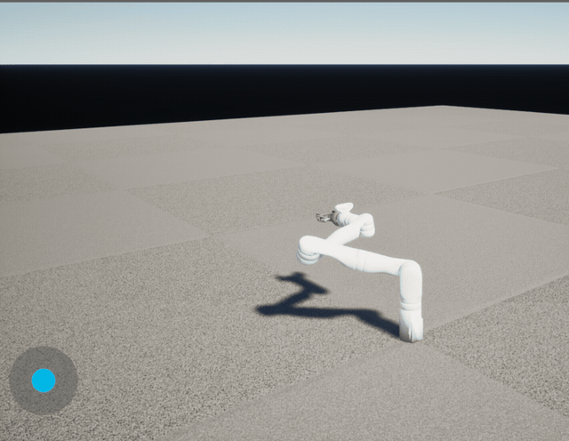</p>

A URLab articulation (a robot or an articulated SimReady object) is one asset for
MuJoCo and Chaos: RammsMujocoSupport builds Chaos bodies and joints from its
compiled MJCF. A level picks the engine with an `ARammsPhysicsSettings` actor
(**Auto**, **MuJoCo** or **Chaos**), and a run can override it with
`-RammsPhysics=MuJoCo|Chaos` or `ramms.Physics.Engine`, so the same level runs
on either without changing its assets. Below, the same doors and drawers under
the same controller on both engines
(`Scripts/pie_tests/chaos_articulation/simready_open.py`):

<p align="center">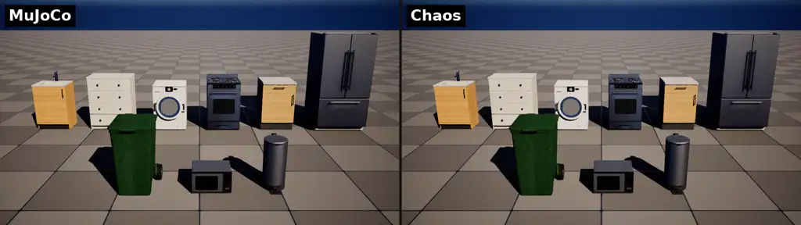</p>

See [base_component_controls.md](base_component_controls.md),
[mujoco_sim_roadmap.md](mujoco_sim_roadmap.md),
[robot_pawn.md](robot_pawn.md),
[chaos_physics_backend_plan.md](chaos_physics_backend_plan.md) and the
[RammsMujocoSupport README](https://github.com/rammp-org/ramms-mujoco-support#readme).

## Accessible Van with Ramp

Articulated accessible van system:
- Controllable van door with keyframe animation
- Articulated van ramp with realistic physics and easing curves

**Components:** `UVanDoorComponent`, `UVanRampComponent`

**Credits:** Custom modification of CC-licensed base model: "Volkswagen ID.
BUZZ" (https://skfb.ly/oTs6B) by Sloftm_Carz, licensed under
[CC-BY 4.0](http://creativecommons.org/licenses/by/4.0/).

## Sensor Simulation

Three sensor types with configurable noise, bias, update rate, and debug
visualization:

| Sensor | Component | Description |
|--------|-----------|-------------|
| **Time-of-Flight** | `URammsToFSensorComponent` | Single-point or NxM grid distance sensor (modeled after VL53L0X / VL53L5CX). GPU or CPU ray tracing. |
| **Sonar / RADAR** | `URammsSonarSensorComponent` | Cone-beam distance sensor with golden-angle spiral ray distribution. GPU or CPU ray tracing. |
| **IMU** | `URammsIMUSensorComponent` | Accelerometer + gyroscope + orientation. Supports gravity, EMA filtering, dead-bands, bias, and noise. |

The ToF and Sonar sensors support **GPU-accelerated ray tracing** via a
compute shader with DXR inline ray tracing (`TraceRayInline`). The GPU path:
- Uses hardware RT cores when available, software ray tracing otherwise
- Falls back automatically to CPU `LineTrace` when GPU is unavailable
- Is controlled per-component via `bUseGPURayTracing` (default: on)
- Shows as `RammsSensorTraceDispatch` in `stat gpu` for profiling

All sensors fire along their local **+X axis** and provide shape
visualization in the editor viewport (frustum for ToF grid, line for ToF
single-point, cone for sonar) with configurable colors and filled planes.

See the [RammsCore README](https://github.com/rammp-org/ramms-core#readme) for detailed sensor
configuration and GPU ray tracing setup.

## Camera Capture System

Production-grade multi-camera capture for simulation and research:

- **Custom camera intrinsics** — Pixel-based parameters (fx, fy, cx, cy)
  for precise real-world camera matching
- **Reusable presets** — Data Assets for sensor profiles (e.g.,
  `DA_RealSense_D435`)
- **Multi-modal output** — RGB, depth (in alpha channel), and motion vectors
  as 32-bit float EXR files with per-frame JSON metadata
- **Semantic segmentation** — a class mask per camera from the custom-depth
  stencil: 8-bit fine and coarse class PNGs per frame, with the class table
  (`segmentation_classes.csv` / `.json`) beside them. Generated worlds come
  labelled (palette slots, surfaces, procedural pieces); pedestrians are
  `Person` and the robot `Robot`. 149 fine classes roll up to 29 coarse ones
  (`Config/DefaultGame.ini`). The camera capture panel's **Classes** button
  turns it on and adds fine and coarse class views, with the class under the
  pointer named below the feed. See
  [Scripts/pie_tests/camera_capture/SEGMENTATION.md](../Scripts/pie_tests/camera_capture/SEGMENTATION.md).
- **Frustum visualization** — Editor viewport shape with filled translucent
  planes

**Components:** `UIntrinsicSceneCaptureComponent2D`, `UCaptureComponent`,
`ACameraCaptureManager`

<table>
  <tr>
    <td width="50%" valign="top">
      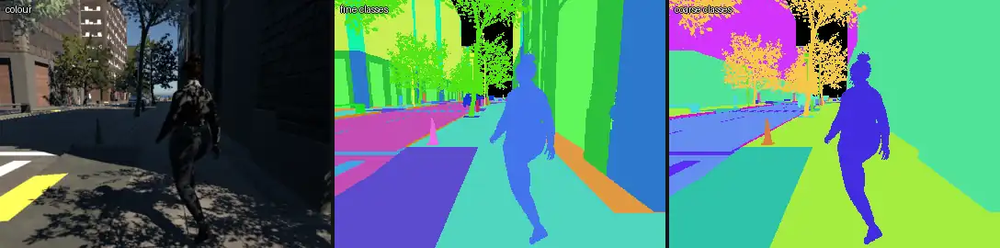<br>
      <sub>Downtown: colour, fine classes, coarse classes.</sub>
    </td>
    <td width="50%" valign="top">
      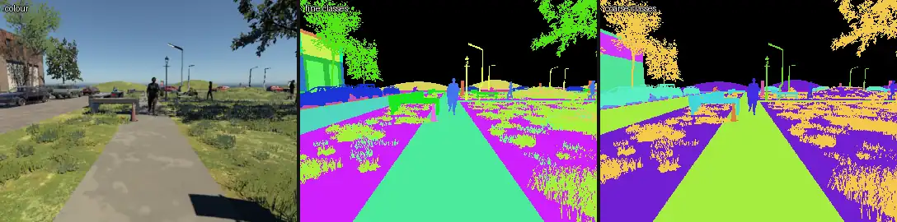<br>
      <sub>Main street square: foliage is cut out leaf by leaf, pedestrians come out whole.</sub>
    </td>
  </tr>
</table>

<p align="center">
  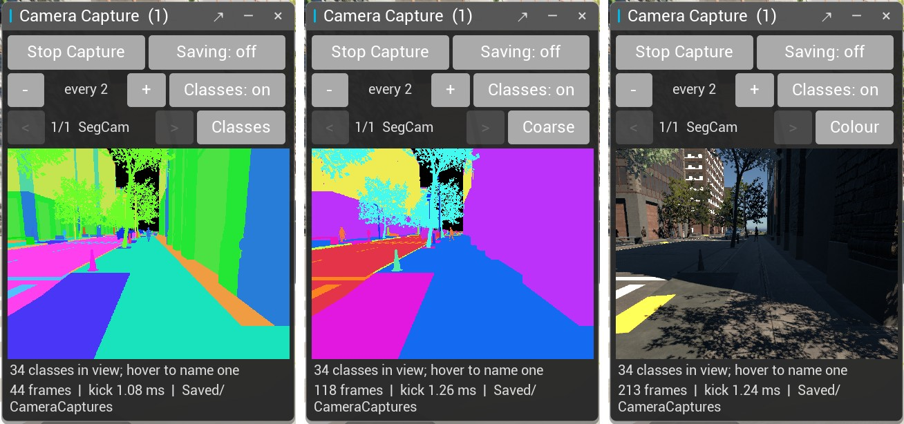<br>
  <sub>The camera capture panel: <b>Classes</b>, <b>Coarse</b> and <b>Colour</b> views of the same camera.</sub>
</p>

## Real-Time Streaming

Binary streaming over TCP for external tools and controllers:

- **RMSS protocol** with 32-byte header + JSON metadata + binary payload
- **Message types:** Image data, depth frames, motion vectors, point clouds,
  subscribe/unsubscribe, ping/ack
- **Compression:** None, LZ4, JPEG, or PNG
- **Default port:** 30030

**Components:** `URammsStreamSourceComponent`, `URammsStreamSinkComponent`,
`URammsStreamingSubsystem`

## Control Surface, UI and Input

A robot **describes** the controls it offers as a control surface (`RammsControl`):
ids such as `drive.forward`, `lift.front_caster_swing_arm`, `arm.up`,
`gripper.close` and `camera.next`, each with a kind, units and a range. Every
input source drives that description through one sink with source
arbitration, so nothing hard-codes a key map or a motor name:

- **In-game panels** (`RammsUI`): floating drive joystick, caster and lift
  sliders, arm pad, camera-capture (colour, depth, motion and class views) and
  status panels, generated from the surface.
- **Keyboard, gamepad and Enhanced Input** maps bound to control ids.
- **RammsAccess**: BCI (OpenBCI Galea), pointer / HID devices (head mice, eye
  gaze) and assistive switches, sent as a versioned intent stream over UDP with
  a silence watchdog and an e-stop latch.
- **Remote clients**: ramms-tools over the Remote Control API, the MCP toolset,
  and Pixel Streaming.

See [base_component_controls.md](base_component_controls.md) and
[ui_input_refactor_plan.md](ui_input_refactor_plan.md).

## Pedestrian Crowds

`RammsCrowd` spawns Mass Entity pedestrians (City Sample Crowds meshes) on
ZoneGraph lanes and NavMesh. They follow lanes, steer and avoid each other and
the robot, and react to it through a stimulus registry: aware, react and
startle zones with hysteresis and a closing-speed rule, tuned per kind in data
assets. The robot pawn is mirrored into Mass so crowds see it without a
character capsule, and its footprint is a hard boundary they walk around. They
plan a pass a few metres out, keeping right when they meet the chair head-on,
turn gently, leave a comfortable gap and slow down alongside it; a parked chair
startles nobody, one driving at them does.
The generated worlds place crowds on their sidewalks.

Each pedestrian is animated by `URammsCrowdAnimInstance` from
`Content/NPCs/DA_CrowdAnimSet`: a walk and idle for their body type, sometimes
a phone, cup, backpack, briefcase or purse in hand, and forward, brisk and
directional walks blended by travel direction and played at the rate that keeps
their feet planted. They turn their heads toward the chair's user once they
notice it and flinch when startled or bumped. See
the [RammsCrowd README](https://github.com/rammp-org/ramms-crowd#readme) and [CUSTOMIZATION.md](https://github.com/rammp-org/ramms-crowd/blob/main/doc/CUSTOMIZATION.md).

## World Generation (procedural, randomized environments)

The `RammsWorldGen` plugin generates pedestrian / wheelchair environments from
a preset and a seed on UE 5.8 PCG — downtown streets with curb ramps and
crosswalks, building entrances (level, stepped, ramped), street furniture and
hazards, suburban lots and parks, and indoor floor plans with doors and
furniture — and emits a ground-truth manifest of routes, clear widths and
accessibility violations per world. `NonCompliance` dials how often features
are generated broken on purpose.

<table>
  <tr>
    <td width="25%" valign="top">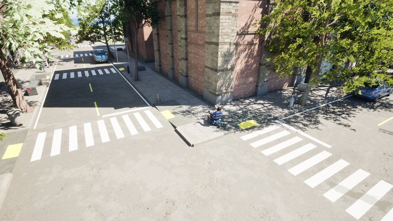<br><sub><b>Downtown</b>: street grid, crosswalks, curb ramps</sub></td>
    <td width="25%" valign="top">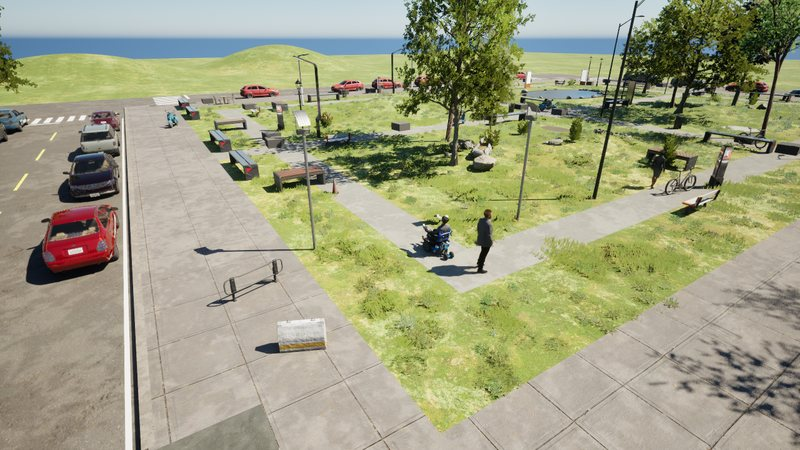<br><sub><b>Main street</b>: street parking, a green square</sub></td>
    <td width="25%" valign="top">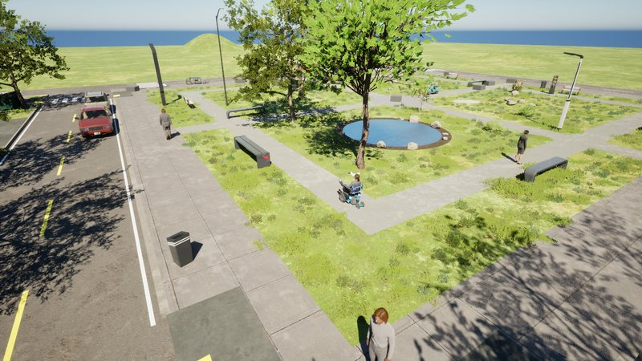<br><sub><b>Suburban</b>: lots, lawns, a pocket park</sub></td>
    <td width="25%" valign="top">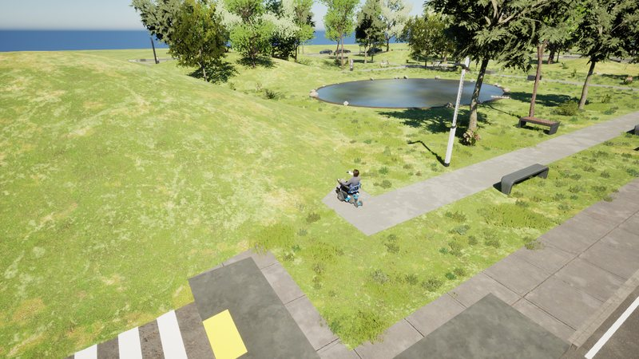<br><sub><b>Park</b>: paths, benches, a pond, hills</sub></td>
  </tr>
  <tr>
    <td width="25%" valign="top">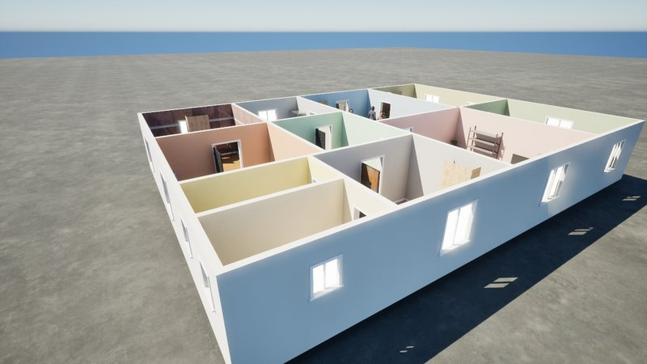<br><sub><b>Home</b>: rooms, doors, thresholds, furniture</sub></td>
    <td width="25%" valign="top">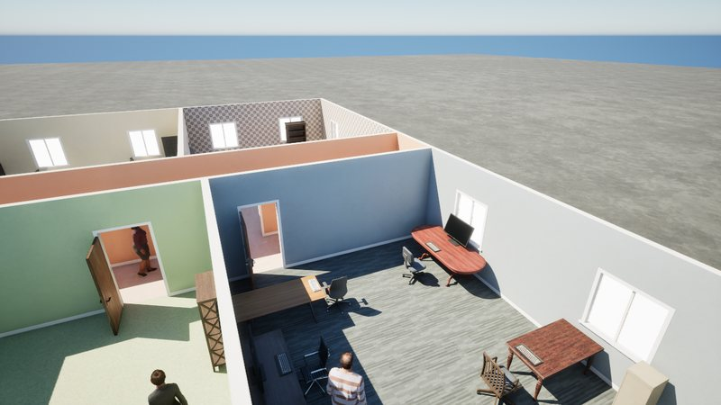<br><sub><b>Office</b>: corridors, offices, desks</sub></td>
    <td width="25%" valign="top">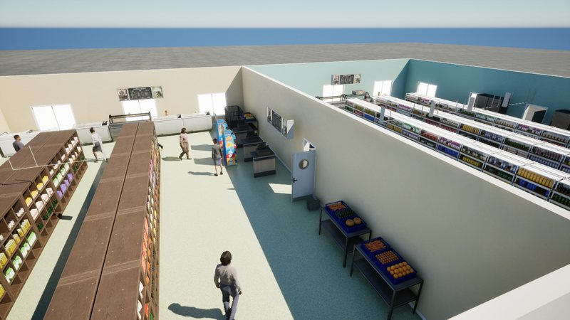<br><sub><b>Store</b>: aisles and shelving</sub></td>
    <td width="25%" valign="top">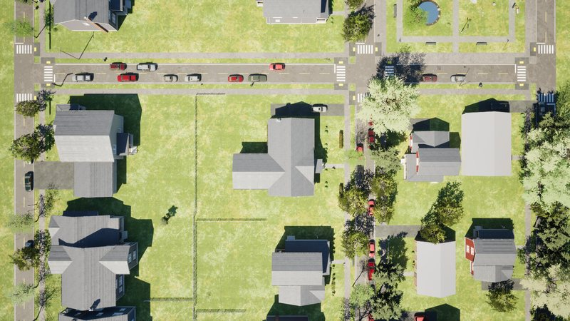<br><sub><b>From above</b>: a suburban block plan</sub></td>
  </tr>
</table>

```
python Scripts/editor_remote_exec.py --file Scripts/worldgen/build_assets.py   # palette, profile, presets, graphs from code
python Scripts/editor_remote_exec.py --file Scripts/worldgen/build_levels.py   # the Map_Gen_* example levels
```

Then open a `/Game/Maps/Gen/Map_Gen_*` level, pick a seed on `WorldGenerator`,
**Regenerate**. The MCP server exposes it as the `RammsWorldGenToolset`
(`worldgen_generate`, `worldgen_randomize`, `worldgen_manifest`, ...), and
ramms-tools as `ramms-worldgen` / `ramms_tools.worldgen` (`ramms-worldgen
generate --preset PRE_Downtown --seed 42`, `ramms-worldgen manifest --issues`,
`ramms-worldgen batch --preset PRE_Park --seeds 1-50 --out data/park`).
See [world_generation.md](world_generation.md) and the
[RammsWorldGen README](https://github.com/rammp-org/ramms-worldgen#readme).

On the SimReady palette, articulated assets (cabinets, chests of drawers, ranges,
vanities, washers, bins) are placed as URLab articulations whose doors and
drawers open, on MuJoCo or Chaos as the level's `ARammsPhysicsSettings` says
(`Scripts/worldgen/simready_level.py`; see [Articulated SimReady assets in
generated levels](https://github.com/rammp-org/ramms-worldgen#articulated-simready-assets-in-generated-levels) in the RammsWorldGen README):

<p align="center">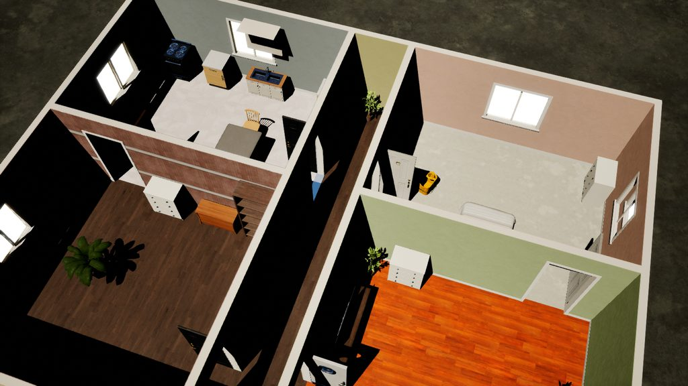 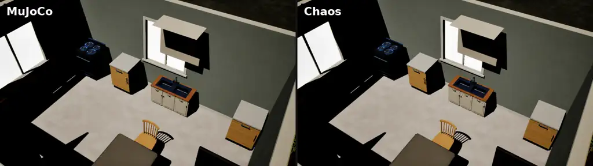</p>

A hand-dressed showcase level (`Scripts/pie_tests/chaos_articulation/simready_showcase.py`) furnishes a whole
home around 20 of these articulations: an L-shaped kitchen with an island, a breakfast nook, living room, bedroom,
bath, laundry and a porch. Here it is on Chaos with `simready_open.py`'s camera paths:

<p align="center">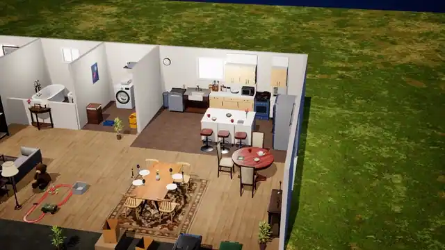 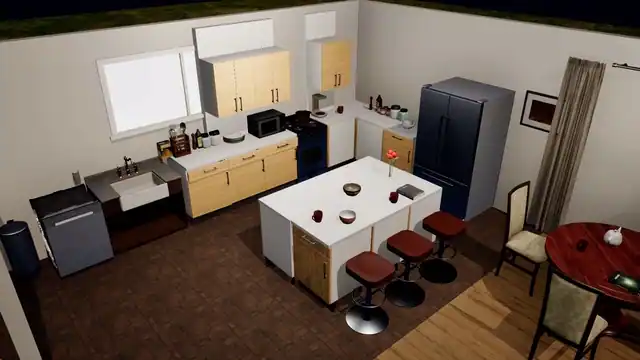</p>

For a robot's sensors, `SC_ENCLOSED` closes the showcase up: a front wall with a front door and windows, a ceiling
with lights, and hinged doors that open and close. The doors come from `ramms_worldgen.doors`, door-leaf meshes
turned into URLab articulations. For generated levels, `simready_level.py`'s `SL_DOORS` and `SL_CEILING` do the
same:

<p align="center">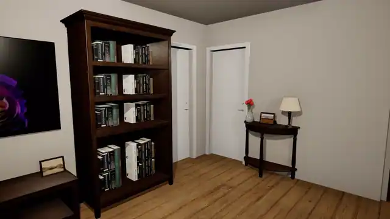</p>

## URDF Interoperability

RammsCore ships bidirectional URDF (Unified Robot Description Format)
conversion for interoperability with ROS, MoveIt, PyBullet, MuJoCo and other
robotics tools: export a Physics Asset (e.g. the Kinova Gen3 arm or the RAMMP Gen1
base) to `<ProjectDir>/urdf/<asset>.urdf`, or import a URDF into a Physics
Asset. The scripts run inside the UE Editor Python console. See the
[RammsCore README](https://github.com/rammp-org/ramms-core#urdf-export--import) for
detailed usage.

## Example Environments

This repository does not include all example environments to keep the
repository size manageable. Additional environments and assets can be
downloaded for free using the **Fab plugin** within Unreal Engine — see
[Download content packs from Fab](getting_started.md#3-download-content-packs-from-fab).
